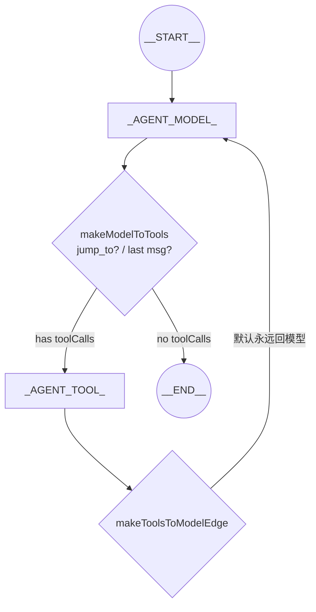

# Spring AI Alibaba ReactAgent 实现原理（源码级分析）

> **分析对象**：`com.alibaba.cloud.ai:spring-ai-alibaba-agent-framework:1.1.2.0` + `com.alibaba.cloud.ai:spring-ai-alibaba-graph-core:1.1.2.0`
>
> **源码来源**：本地 Maven 仓库中的 `-sources.jar`，已完整解压到 [`sources/`](sources)，本文所有行号均可直接对照。
>
> **分析路径**：本项目 [`App.java`](src/main/java/edu/whpu/App.java) 使用的 `ReactAgent.builder().model(...).tools(...).instruction(...).build()` → `agent.call("...")` 同步路径；`stream(...)`、多轮记忆、HITL 作为同一条执行链上的分支单独说明。
>
> **验证方式**：用一个确定性的伪 `ChatModel` 替换真实大模型（无需 API Key），跑通同步、流式、多轮、递归上限、HITL 中断/恢复五组场景。复现脚本见 [`output/trace/`](output/trace)，实测日志见第 4.7、8.5、9.3、10.4 节。

---

## 0. 先给结论

1. **ReactAgent 不是一个带 `while` 循环的类**。`build()` 阶段它被编译成一张 `StateGraph`：两个业务节点 `_AGENT_MODEL_` 和 `_AGENT_TOOL_`，再由条件边把二者连成环。**“循环”是图引擎在运行时一节点一节点地递归推进**，不是 Agent 类里手写的循环。
2. **一次 `call(question)` 的骨架**是：
   ```text
   __START__ → _AGENT_MODEL_ ──有 toolCalls──→ _AGENT_TOOL_ ──默认──→ _AGENT_MODEL_ → ...
                        └──无 toolCalls──→ __END__
   ```
   模型每被调用一次就产出一条 `AssistantMessage`；工具有调用就产出一条 `ToolResponseMessage`，二者都通过 `AppendStrategy` 追加进 `OverAllState["messages"]`。
3. **“问题是否解决”的唯一控制信号是最后一条消息的类型**：`makeModelToTools` 检查最后一条 `AssistantMessage.hasToolCalls()`。没有工具调用 = 模型认为可以回答了 = 路由到 `END`。框架**不做**语义上的“答案正确性判断”，也没有单独的反思/评估节点。
4. **真正的推进代码在 graph-core**：`MainGraphExecutor.execute → NodeExecutor.executeNode → handleActionResult → concatWith(Flux.defer(() -> mainGraphExecutor.execute(...)))`，用一个 Reactor 流把“执行一个节点 → 合并状态 → 计算下一条边 → 打 checkpoint → 再执行下一个节点”串起来。
5. **每轮 ReAct（模型一次 + 工具一次）会消耗 2 个图执行 tick**；`recursionLimit` 数的是图 tick（含 START/END），不是“模型轮数”。`ReactAgent.Builder` 默认把 `recursionLimit` 设成 `Integer.MAX_VALUE`，所以**默认几乎不会因上限停止**，需要自己设上限或用 `ModelCallLimitHook` / `ToolCallLimitHook`。
6. **默认没有多轮记忆**：`Builder` 未显式配置 `saver` 时，`SaverConfig` 里登记的是 `null`，`checkpointSaver()` 为空，每次 `call` 都从空 `messages` 开始。只有显式 `.saver(...)`，或传入一个未覆盖 `saverConfig` 的 `CompileConfig`（其字段默认带 `MemorySaver`），才会按 `threadId` 记住历史。
7. **工具调用循环的下限与上限都在 `AgentToolNode`/`AgentLlmNode` 里**：工具串行/并行执行、异常转错误结果、超时取消；模型异常不会抛出，而是变成一条 `AssistantMessage("Exception: ...")`，于是循环“正常结束”。

一句话总结：

> **Agent = 一张编译好的图；一次提问 = 从 START 到 END 的图遍历；循环 = 模型/工具两个节点之间的条件边；终止 = 模型不再发 tool call（或 hook/limit/interrupt 把它送出环外）。**

---

## 1. 整体架构：Agent 只是 Graph 的一层壳

### 1.1 模块分工

```text
agent-framework（Agent 语义层）
└── com.alibaba.cloud.ai.graph.agent
    ├── Agent / BaseAgent               公共属性、invoke/stream 模板方法、asNode
    ├── ReactAgent                      ReAct 语义、图拓扑装配、消息提取
    ├── Builder / DefaultBuilder        把 model/tools/instruction/hooks 组装成 ReactAgent
    ├── node.AgentLlmNode               “Thought/Action”节点：调模型
    ├── node.AgentToolNode              “Observation”节点：执行工具
    ├── hook.*                          BEFORE/AFTER_AGENT、BEFORE/AFTER_MODEL 钩子
    └── interceptor.*                   ModelInterceptor / ToolInterceptor 责任链

graph-core（图执行引擎）
└── com.alibaba.cloud.ai.graph
    ├── StateGraph / CompiledGraph      图定义与编译
    ├── GraphRunner                     一次运行的入口
    ├── GraphRunnerContext              运行期上下文：状态、当前/下一节点、迭代计数
    ├── executor.MainGraphExecutor      START/END/中断/节点分派
    ├── executor.NodeExecutor           执行单个节点并递归推进
    ├── OverAllState / KeyStrategy      全局状态与合并策略
    ├── checkpoint.*                    checkpoint 持久化（MemorySaver 等）
    └── streaming.*                     流式输出封装
```

### 1.2 关键类地图

| 层次 | 类 | 职责 | 关键位置 |
|---|---|---|---|
| 入口 | `ReactAgent` | 构建图、暴露 `call/invoke/stream` | [ReactAgent.java:156](sources/agent-framework/com/alibaba/cloud/ai/graph/agent/ReactAgent.java#L156) |
| 入口 | `Agent` | `doInvoke/doStream` 模板方法 | [Agent.java:497](sources/agent-framework/com/alibaba/cloud/ai/graph/agent/Agent.java#L497) |
| 构建 | `DefaultBuilder` | 创建 ChatClient、`AgentLlmNode`、`AgentToolNode`、汇总工具 | [DefaultBuilder.java:52](sources/agent-framework/com/alibaba/cloud/ai/graph/agent/DefaultBuilder.java#L52) |
| 编译 | `StateGraph` | `addNode/addEdge/addConditionalEdges/compile` | [StateGraph.java:517](sources/graph-core/com/alibaba/cloud/ai/graph/StateGraph.java#L517) |
| 运行 | `GraphRunner` | 构造 `GraphRunnerContext`，委托 `MainGraphExecutor` | [GraphRunner.java:48](sources/graph-core/com/alibaba/cloud/ai/graph/GraphRunner.java#L48) |
| 运行 | `GraphRunnerContext` | 初始化/合并状态、路由、checkpoint、迭代计数 | [GraphRunnerContext.java:81](sources/graph-core/com/alibaba/cloud/ai/graph/GraphRunnerContext.java#L81) |
| 运行 | `MainGraphExecutor` | START/END/中断判断与节点分派 | [MainGraphExecutor.java:57](sources/graph-core/com/alibaba/cloud/ai/graph/executor/MainGraphExecutor.java#L57) |
| 运行 | `NodeExecutor` | 执行单节点 + 递归推进 | [NodeExecutor.java:94](sources/graph-core/com/alibaba/cloud/ai/graph/executor/NodeExecutor.java#L94) |
| 状态 | `OverAllState` | `Map` + 每 key 的 `KeyStrategy` | [OverAllState.java:263](sources/graph-core/com/alibaba/cloud/ai/graph/OverAllState.java#L263) |
| 模型 | `AgentLlmNode` | 提示词组装、拦截器、同步/流式调用 | [AgentLlmNode.java:135](sources/agent-framework/com/alibaba/cloud/ai/graph/agent/node/AgentLlmNode.java#L135) |
| 工具 | `AgentToolNode` | 解析、拦截、串/并行执行、回写 `ToolResponseMessage` | [AgentToolNode.java:154](sources/agent-framework/com/alibaba/cloud/ai/graph/agent/node/AgentToolNode.java#L154) |
| 路由 | `ReactAgent` 内部 `EdgeAction` | `makeModelToTools` / `makeToolsToModelEdge` | [ReactAgent.java:749](sources/agent-framework/com/alibaba/cloud/ai/graph/agent/ReactAgent.java#L749) |

### 1.3 ReactAgent 持有的东西

`ReactAgent` 构造时（[ReactAgent.java:114-153](sources/agent-framework/com/alibaba/cloud/ai/graph/agent/ReactAgent.java#L114)）持有：

- `llmNode`（`AgentLlmNode`，模型节点实例）
- `toolNode`（`AgentToolNode`，工具节点实例）
- `hasTools`：`toolNode.getToolCallbacks()` 非空才为 `true`（[153](sources/agent-framework/com/alibaba/cloud/ai/graph/agent/ReactAgent.java#L153)）。**没有工具就根本不注册工具节点，也不画环**。
- `hooks`、`compileConfig`、`saver`、`outputKey` 等配置
- `threadIdStateMap`：给 `InterruptionHook` 用的“按线程的人类反馈暂存区”（[ReactAgent.java:956](sources/agent-framework/com/alibaba/cloud/ai/graph/agent/ReactAgent.java#L956)）

---

## 2. 构建阶段：`build()` 如何把 Agent 编译成图

### 2.1 builder 调用链

```java
ReactAgent.builder()                       // ReactAgent.java:156
  -> new DefaultAgentBuilderFactory().builder()  // 返回 DefaultBuilder
  -> DefaultBuilder.build()                // DefaultBuilder.java:52
  -> new ReactAgent(...)                  // 真正把 llmNode/toolNode/hooks 装进去
```

`DefaultBuilder.build()` 做四件事（[DefaultBuilder.java:52-190](sources/agent-framework/com/alibaba/cloud/ai/graph/agent/DefaultBuilder.java#L52)）：

1. 校验 `name` 非空、`model` 或 `chatClient` 至少一个；
2. 没有 `chatClient` 就用 `ChatClient.builder(model...)` 建一个；
3. 用 `AgentLlmNode.builder()` 组装模型节点：chatClient、chatOptions、outputKey、systemPrompt、instruction、modelInterceptors、advisors；
4. `gatherLocalTools(...)` 汇总三类工具：hook 提供的、interceptor 提供的、用户显式传入的（[DefaultBuilder.java:190](sources/agent-framework/com/alibaba/cloud/ai/graph/agent/DefaultBuilder.java#L190)），再交给 `AgentToolNode.Builder`。

### 2.2 `initGraph()`：注册节点与边

`ReactAgent.initGraph()`（[ReactAgent.java:303](sources/agent-framework/com/alibaba/cloud/ai/graph/agent/ReactAgent.java#L303)）先建 `StateGraph`，再按“有无工具/hook”拼拓扑：

```java
StateGraph graph = new StateGraph(name, buildMessagesKeyStrategyFactory(hooks), stateSerializer);

graph.addNode(AGENT_MODEL_NAME, node_async(this.llmNode));   // _AGENT_MODEL_
if (hasTools) {
    graph.addNode(AGENT_TOOL_NAME, node_async(this.toolNode)); // _AGENT_TOOL_
}
```

- `AGENT_MODEL_NAME = "_AGENT_MODEL_"`、`AGENT_TOOL_NAME = "_AGENT_TOOL_"` 定义在 [RunnableConfig.java:42-43](sources/graph-core/com/alibaba/cloud/ai/graph/RunnableConfig.java#L42)。
- `node_async(...)` 把同步的 `NodeActionWithConfig` 包成 `AsyncNodeActionWithConfig`，异常转成 `CompletableFuture` 的异常（[AsyncNodeActionWithConfig.java:36](sources/graph-core/com/alibaba/cloud/ai/graph/action/AsyncNodeActionWithConfig.java#L36)）。

### 2.3 普通 Agent（无 hook）的最终拓扑

假设只有 `model + tools + instruction`，没有 hook：



实测由 `CompiledGraph.getGraph(Type.MERMAID)` 输出的边（伪模型场景）：

```text
__START__ --> _AGENT_MODEL_
_AGENT_MODEL_ -.-> condition1
condition1 -.-> _AGENT_TOOL_
condition1 -.-> _AGENT_MODEL_
condition1 -.-> __END__
_AGENT_TOOL_ -.-> condition2
condition2 -.-> __END__
condition2 -.-> _AGENT_MODEL_
```

`condition1` 的三种去向就是 `makeModelToTools` 可能返回的三个值；映射表在 [ReactAgent.java:709](sources/agent-framework/com/alibaba/cloud/ai/graph/agent/ReactAgent.java#L709)：

```java
graph.addConditionalEdges(
    loopExitNode,
    edge_async(agentInstance.makeModelToTools(loopEntryNode, exitNode)),
    Map.of(AGENT_TOOL_NAME, AGENT_TOOL_NAME,
           exitNode, exitNode,
           loopEntryNode, loopEntryNode));
```

> **注意**：`condition2` 里虽然有 `__END__`，但 `makeToolsToModelEdge` 目前**永远不会**返回 `endDestination`（[ReactAgent.java:830](sources/agent-framework/com/alibaba/cloud/ai/graph/agent/ReactAgent.java#L830) 是 `return false; // FIXME`）。也就是说“工具执行完直接结束”在图层面是死路径，工具节点之后总是回模型。

### 2.4 Hook 存在时的拓扑

Hook 会被提升为**真实的图节点**（[ReactAgent.java:339-380](sources/agent-framework/com/alibaba/cloud/ai/graph/agent/ReactAgent.java#L339)）：

| Hook 位置 | 节点 ID | 执行方式 |
|---|---|---|
| `BEFORE_AGENT` | `_AGENT_HOOK_<name>.before` | 正序链：entry → hook0 → hook1 → ... → loopEntry |
| `AFTER_AGENT` | `_AGENT_HOOK_<name>.after` | 逆序链：exitNode(last) → ... → hook0 → END |
| `BEFORE_MODEL` | `_AGENT_HOOK_<name>.beforeModel` | 正序链：loopEntry → hook0 → ... → model |
| `AFTER_MODEL` | `_AGENT_HOOK_<name>.afterModel` | 逆序链：model → last → ... → hook0 → 工具路由 |

对应代码：

- 入口节点 = 第一个 `BEFORE_AGENT`，否则第一个 `BEFORE_MODEL`，否则 `_AGENT_MODEL_`（[ReactAgent.java:501](sources/agent-framework/com/alibaba/cloud/ai/graph/agent/ReactAgent.java#L501)）。
- 循环入口 = 第一个 `BEFORE_MODEL`，否则模型（[514](sources/agent-framework/com/alibaba/cloud/ai/graph/agent/ReactAgent.java#L514)）。
- 循环出口 = 第一个 `AFTER_MODEL`，否则模型（[524](sources/agent-framework/com/alibaba/cloud/ai/graph/agent/ReactAgent.java#L524)）。
- 整体出口 = 最后一个 `AFTER_AGENT`，否则 `END`（[534](sources/agent-framework/com/alibaba/cloud/ai/graph/agent/ReactAgent.java#L534)）。
- 所有 hook 边由 `setupHookEdges` + `chainHook/chainModelHookReverse/chainAgentHookReverse` 拼装（[544](sources/agent-framework/com/alibaba/cloud/ai/graph/agent/ReactAgent.java#L544)）。

> 这里的“逆序”值得注意：`AFTER_MODEL` hook 在列表里排第一的，**最后**执行，并且是工具路由的 `loopExitNode`。`filterHooksByPosition`（[ReactAgent.java:471](sources/agent-framework/com/alibaba/cloud/ai/graph/agent/ReactAgent.java#L471)）先按位置过滤，再按 `getOrder()` 升序排序（同 order 保持注册顺序；`ModelHook` 的默认 order 是 0）。所以 `HIGHEST_PRECEDENCE = Integer.MIN_VALUE` 的 afterModel hook 在列表最前、执行链最末；`BEFORE_MODEL` 则是正序，`HIGHEST_PRECEDENCE` 第一个跑（`ReturnDirectModelHook` 依赖这一点）。

### 2.5 状态 schema：为什么消息会自动变长

`buildMessagesKeyStrategyFactory`（[ReactAgent.java:727](sources/agent-framework/com/alibaba/cloud/ai/graph/agent/ReactAgent.java#L727)）：

```java
keyStrategyHashMap.put("messages", new AppendStrategy());
if (outputKey != null) {
    keyStrategyHashMap.put(outputKey, outputKeyStrategy == null ? new ReplaceStrategy() : outputKeyStrategy);
}
// 加上 hook.getKeyStrategys()
```

`AppendStrategy.apply(old, new)`（[AppendStrategy.java:43](sources/graph-core/com/alibaba/cloud/ai/graph/state/strategy/AppendStrategy.java#L43)）的核心行为：

- `newValue` 是 `List`：把旧 list 和新 list 拼起来；
- `newValue` 是单条 `Message`：`oldList.add(newValue)`；
- `newValue == null`：保留旧值；
- 支持 `ReplaceAllWith`（整体替换）和 `RemoveByHash`（按内容删除一条）。

因此 `AgentLlmNode` 只需返回 `{"messages": assistantMessage}`，`AgentToolNode` 只需返回 `{"messages": toolResponseMessage}`，状态机天然就把对话历史累积起来了，不需要节点自己去 `get + add + set`。

### 2.6 编译：`CompiledGraph`

`StateGraph.compile(CompileConfig)`（[StateGraph.java:517](sources/graph-core/com/alibaba/cloud/ai/graph/StateGraph.java#L517)）会 `validateGraph()`（检查 START 边、节点/边引用、条件映射完整性），然后构造 `CompiledGraph`：

- `maxIterations = compileConfig.recursionLimit()`（[CompiledGraph.java:99](sources/graph-core/com/alibaba/cloud/ai/graph/CompiledGraph.java#L99)）；
- 把节点保存成 `Node.ActionFactory`，等到运行时才 `apply(config)` 创建 action（[CompiledGraph.java:491](sources/graph-core/com/alibaba/cloud/ai/graph/CompiledGraph.java#L491)）；
- 保存条件边与 `keyStrategyMap`。

> 编译是**懒**的：`ReactAgent.getCompiledGraph()` 默认是 `null`，第一次 `call/invoke/stream` 时由 `getAndCompileGraph()` 加锁编译（[Agent.java:116](sources/agent-framework/com/alibaba/cloud/ai/graph/agent/Agent.java#L116)）。所以直接调 `agent.getCompiledGraph().getGraph(...)` 会 NPE，应先 `agent.getAndCompileGraph()`。

---

## 3. 入口：一次问题如何进入图

### 3.1 API 到图的映射

| Agent API | 最终调用 | `_stream_` | 说明 |
|---|---|---|---|
| `call(String/UserMessage/List/Map)` | `doInvoke` → `compiledGraph.invoke` | `false` | 同步，返回最后一条 `AssistantMessage` |
| `invoke(...)` | `doInvoke` → `compiledGraph.invoke` | `false` | 同步，返回 `Optional<OverAllState>` |
| `invokeAndGetOutput(...)` | `doInvokeAndGetOutput` → `invokeAndGetOutput` | `false` | 同步，返回最后一个 `NodeOutput`（HITL 时是 `InterruptionMetadata`） |
| `stream(...)` | `doStream` → `compiledGraph.stream` | 默认 `true` | 流式 `Flux<NodeOutput>` |
| `streamMessages(...)` | `doStream` → 过滤 | 默认 `true` | 只保留模型流式 chunk 和工具完成消息 |

`Agent.doInvoke` 只有两行（[Agent.java:497](sources/agent-framework/com/alibaba/cloud/ai/graph/agent/Agent.java#L497)）：

```java
CompiledGraph compiledGraph = getAndCompileGraph();
return compiledGraph.invoke(input, buildNonStreamConfig(runnableConfig));
```

`buildNonStreamConfig` 往 `RunnableConfig` 的 metadata 里塞两个键（[Agent.java:512](sources/agent-framework/com/alibaba/cloud/ai/graph/agent/Agent.java#L512)）：

```java
builder.addMetadata("_stream_", false).addMetadata("_AGENT_", name);
```

`_stream_` 就是 `AgentLlmNode` 用来选同步/流式分支的开关（[AgentLlmNode.java:203](sources/agent-framework/com/alibaba/cloud/ai/graph/agent/node/AgentLlmNode.java#L203)）。`_AGENT_` 会写进每个 `NodeOutput`，用于标识输出来自哪个 agent。

### 3.2 输入装配：`buildMessageInput`

`buildMessageInput`（[Agent.java:545](sources/agent-framework/com/alibaba/cloud/ai/graph/agent/Agent.java#L545)）：

```java
inputs.put("messages", messages);      // List<Message>
inputs.put("input", lastUserMessage.getText());
```

- `messages` 是真正的对话输入；
- `input` 便于把 Agent 当普通图节点使用时从 `input` 取文本（`AgentLlmNode` 在 `messages` 缺失时会回退到 `input`，[AgentLlmNode.java:153-159](sources/agent-framework/com/alibaba/cloud/ai/graph/agent/node/AgentLlmNode.java#L153)）。

### 3.3 `RunnableConfig`：线程、checkpoint、元数据

`RunnableConfig`（[RunnableConfig.java:40](sources/graph-core/com/alibaba/cloud/ai/graph/RunnableConfig.java#L40)）里和 ReAct 循环直接相关的字段/键：

| 字段/键 | 作用 |
|---|---|
| `threadId` | 会话线程；checkpoint saver 按它分组 |
| `checkPointId` | 指定从哪个 checkpoint 恢复 |
| `nextNode` | 内部用，恢复时的下一节点 |
| `metadata` | 不可变运行环境：`_stream_`、`_AGENT_`、`HUMAN_FEEDBACK` 等 |
| `context` | 可变运行上下文：模型迭代计数、动态工具回调等；**不持久化** |
| `interruptedNodes` | 节点级中断标记（`config.isInterrupted(nodeId)`） |

关键常量：

- `HUMAN_FEEDBACK_METADATA_KEY = "HUMAN_FEEDBACK"`（[48](sources/graph-core/com/alibaba/cloud/ai/graph/RunnableConfig.java#L48)）；
- `DYNAMIC_TOOL_CALLBACKS_METADATA_KEY = "_DYNAMIC_TOOL_CALLBACKS_"`（[59](sources/graph-core/com/alibaba/cloud/ai/graph/RunnableConfig.java#L59)）。

### 3.4 初始状态：checkpoint 与本次输入如何合并

`GraphRunnerContext` 构造时先判断“新运行”还是“恢复”（[GraphRunnerContext.java:86](sources/graph-core/com/alibaba/cloud/ai/graph/GraphRunnerContext.java#L86)）：

```java
if (config.metadata(HUMAN_FEEDBACK_METADATA_KEY).isPresent() || config.checkPointId().isPresent()) {
    initializeFromResume(...);
} else {
    initializeFromStart(...);
}
```

**新运行**（`initializeFromStart`，[123](sources/graph-core/com/alibaba/cloud/ai/graph/GraphRunnerContext.java#L123)）：

```java
this.overallState = stateCreate(compiledGraph.getInitialState(inputs, config), initialState);
this.currentNodeId = START;
this.nextNodeId = null;
```

`getInitialState`（[CompiledGraph.java:458](sources/graph-core/com/alibaba/cloud/ai/graph/CompiledGraph.java#L458)）是关键：

```java
return compileConfig.checkpointSaver()
        .flatMap(saver -> saver.get(config))                     // 取该 threadId 最新 checkpoint
        .map(cp -> OverAllState.updateState(cp.getState(), inputs, keyStrategyMap))
        .orElseGet(() -> OverAllState.updateState(new HashMap<>(), inputs, keyStrategyMap));
```

- **有 saver**：先取 checkpoint 里的历史状态，再用 `keyStrategyMap` 把本次 `inputs` 合并进去。`messages` 是 `AppendStrategy`，于是新问题**追加**在旧对话后面。
- **无 saver**：从空 map 开始，只放本次输入。

这就解释了“为什么有时 Agent 记得上一轮，有时不记得”：取决于 saver 是否存在，而不是 Agent 对象本身。

**恢复运行**（`initializeFromResume`，[93](sources/graph-core/com/alibaba/cloud/ai/graph/GraphRunnerContext.java#L93)）：

```java
var checkpoint = saver.get(config)...;
this.currentNodeId = null;
this.nextNodeId = checkpoint.getNextNodeId();   // 从上次 checkpoint 的下一节点继续
this.overallState = initialState.input(checkpoint.getState());
this.resumeFrom = checkpoint.getNodeId();       // 用于 interruptBeforeEdge 等逻辑
```

注意：恢复时**不会重跑** checkpoint 里 `nodeId` 代表的那个已完成节点，而是从 `nextNodeId` 继续。

---

## 4. 运行时：一次提问的完整循环

### 4.1 `GraphRunner`：一次运行一个 Context

```java
public Flux<GraphResponse<NodeOutput>> run(OverAllState initialState) {
    return Flux.defer(() -> {
        GraphRunnerContext context = new GraphRunnerContext(initialState, config, compiledGraph);
        return mainGraphExecutor.execute(context, resultValue);
    });
}
```

（[GraphRunner.java:48](sources/graph-core/com/alibaba/cloud/ai/graph/GraphRunner.java#L48)）

所有运行期可变状态都收在 `GraphRunnerContext` 里：`overallState`、`currentNodeId`、`nextNodeId`、`iteration`、`resumeFrom`、`tokenUsage`。图节点本身基本无状态，所以同一个 `ReactAgent` 可以被多线程复用（各自一个 `RunnableConfig`/Context）。

### 4.2 `MainGraphExecutor.execute`：每个 tick 的“总调度”

（[MainGraphExecutor.java:57](sources/graph-core/com/alibaba/cloud/ai/graph/executor/MainGraphExecutor.java#L57)）

```text
execute(context):
  1. shouldStop() || isMaxIterationsReached()  -> handleCompletion（结束）
  2. returnFromEmbed 存在              -> 返回内嵌子图的返回值 / 中断
  3. 当前节点被标记 interrupted         -> done(当前状态)
  4. currentNodeId == START            -> handleStartNode
  5. nextNodeId == END                 -> handleEndNode
  6. shouldInterrupt()                 -> done(InterruptionMetadata)
  7. 其他                              -> NodeExecutor.executeNode
```

逐条说明：

1. **`isMaxIterationsReached` 每次进入都自增**（[GraphRunnerContext.java:157-158](sources/graph-core/com/alibaba/cloud/ai/graph/GraphRunnerContext.java#L157)）：
   ```java
   return iteration.incrementAndGet() > compiledGraph.getMaxIterations();
   ```
   超过就 `handleCompletion`：把当前 `overallState.data()` 复制进 `resultValue`，**不抛异常**。所以递归上限是“优雅截断”，不是错误。
2. **START**（[MainGraphExecutor.java:123](sources/graph-core/com/alibaba/cloud/ai/graph/executor/MainGraphExecutor.java#L123)）：
   - `doListeners(START, null)`；
   - `getEntryPoint()` 计算入口节点（触发 START 的条件边，通常是直接的 `START → entryNode`）；
   - `addCheckpoint(START, nextNodeId)`；
   - `buildOutput(START, cp)` 产出第一条 `NodeOutput`；
   - `setCurrentNodeId(nextNodeId)`；
   - `concatWith(Flux.defer(() -> execute(context, ...)))` → 进入下一 tick。
3. **END**（[148](sources/graph-core/com/alibaba/cloud/ai/graph/executor/MainGraphExecutor.java#L148)）：`doListeners(END)` → `buildNodeOutput(END)` → `handleCompletion`。END 不是节点 action，只是在 tick 顶部被识别。
4. **图级中断**：`shouldInterrupt`（[GraphRunnerContext.java:169](sources/graph-core/com/alibaba/cloud/ai/graph/GraphRunnerContext.java#L169)）检查 `compileConfig.interruptsBefore/interruptsAfter/interruptBeforeEdge`；命中就产出 `InterruptionMetadata`（`done` 而非普通输出），由调用方恢复。
5. **其余情况**交给 `NodeExecutor`。

### 4.3 `NodeExecutor.executeNode`：真正执行一个节点

（[NodeExecutor.java:94](sources/graph-core/com/alibaba/cloud/ai/graph/executor/NodeExecutor.java#L94)）

```java
context.setCurrentNodeId(context.getNextNodeId());
AsyncNodeActionWithConfig action = context.getNodeAction(currentNodeId);

if (action instanceof InterruptableAction) {
    // 先让可中断节点有机会在 apply 前中断（HITL/InterruptionHook 在这一步）
    Optional<InterruptionMetadata> meta = action.interrupt(...);
    if (meta.isPresent()) {
        resultValue.set(meta.get());
        return Flux.just(GraphResponse.done(meta.get()));   // 不合并状态、不推进
    }
}

context.doListeners(NODE_BEFORE, null);
CompletableFuture<Map<String,Object>> future = action.apply(state, config);
return Mono.fromFuture(future).flatMapMany(updateState -> handleActionResult(...));
```

注意顺序：

1. `currentNodeId = nextNodeId`（上一 tick 已算好）；
2. **`interrupt` 在 `apply` 之前**。`HumanInTheLoopHook` 就是靠这一点，在模型已经产出 tool call、但工具尚未执行时把图停下来；
3. `NODE_BEFORE` 监听器；
4. 执行 action，拿到 `updateState`（`Map<String,Object>`）；
5. 进入 `handleActionResult`。

### 4.4 `handleActionResult`：合并、路由、checkpoint、递归

这是整个循环的核心（[NodeExecutor.java:146](sources/graph-core/com/alibaba/cloud/ai/graph/executor/NodeExecutor.java#L146)），按顺序：

```text
1. 如果 updateState 里有 Flux          -> handleEmbeddedFlux（流式分支，见第 8 节）
2. 如果 updateState 里有 ParallelGraphFlux / GraphFlux -> 并行/图流分支
3. 如果 action 是 InterruptableAction  -> interruptAfter(...)（apply 之后、合并之前的中断）
4. mergeIntoCurrentState(updateState)  // ← 状态合并
5. interruptBeforeEdge / interruptsAfter 命中 -> nextNodeId = "__INTERRUPTED__"
   否则 nextNodeId = nextNodeId(currentNodeId, 合并后的 state)  // ← 路由
6. buildNodeOutputAndAddCheckpoint(updateState) // ← 快照 + checkpoint
7. doListeners(NODE_AFTER)
8. Flux.of(output).concatWith(Flux.defer(() -> mainGraphExecutor.execute(...))) // ← 下一 tick
```

第 4 步 `mergeIntoCurrentState`（[GraphRunnerContext.java:336](sources/graph-core/com/alibaba/cloud/ai/graph/GraphRunnerContext.java#L336)）：

```java
Map<String,Object> filteredState = findTokenUsageInDeltaState(updateState); // 摘出 _TOKEN_USAGE_
this.overallState.updateState(filteredState);
```

`OverAllState.updateState`（[OverAllState.java:263](sources/graph-core/com/alibaba/cloud/ai/graph/OverAllState.java#L263)）：

```java
KeyStrategy strategy = keyStrategies.get(key);
if (strategy == null) strategy = KeyStrategy.REPLACE;
this.data.put(key, strategy.apply(value(key, null), partialState.get(key)));
```

所以 `messages` 走 `AppendStrategy`，`jump_to` 等没有专门注册的 key 走默认 `REPLACE`。

第 5 步 `nextNodeId`（[GraphRunnerContext.java:199-234](sources/graph-core/com/alibaba/cloud/ai/graph/GraphRunnerContext.java#L199)）：

```java
var singleAction = edgeCondition.singleAction();
var command = singleAction.apply(this.overallState, config).get();  // 路由函数看到的是合并后状态
var newRoute = command.gotoNode();
String result = route.value().mappings().get(newRoute);              // 路由结果 → 目标节点
this.mergeIntoCurrentState(command.update());                        // 路由函数也能带状态更新
return new Command(result, state);
```

> 顺序非常关键：**先合并本节点输出，再跑条件边**。所以 `makeModelToTools` 能看到刚追加的 `AssistantMessage`；`makeToolsToModelEdge` 能看到刚追加的 `ToolResponseMessage`。

第 6 步 `buildNodeOutputAndAddCheckpoint`（[GraphRunnerContext.java:244](sources/graph-core/com/alibaba/cloud/ai/graph/GraphRunnerContext.java#L244)）在 saver 存在时，把“当前节点、当前状态快照、下一节点”写成一条新 checkpoint：

```java
Checkpoint cp = Checkpoint.builder()
        .nodeId(nodeId)
        .state(cloneState(overallState.data()))
        .nextNodeId(nextNodeId)
        .build();
saver.put(appendConfig, cp);   // checkPointId 强制 null，追加而不是覆盖
```

第 8 步的 `Flux.defer` 是“循环”的真正发动机：**上一个节点的输出发出后，才订阅下一个 tick**。`GraphRunnerContext` 不变，`resultValue` 一路传下去，直到 `handleCompletion` 把它设成最终 state（[BaseGraphExecutor.java:52](sources/graph-core/com/alibaba/cloud/ai/graph/executor/BaseGraphExecutor.java#L52)）。

### 4.5 循环伪代码（把上面拼起来）

```text
run(question):
  inputs = {messages:[UserMessage(question)], input: question}
  state = checkpoint ? checkpoint.state + inputs : empty + inputs
  context = new Context(state)
  emit(execute(context))

execute(context):                       # 一个 tick
  if context.maxIterationsReached(): return complete(context)
  if currentNode == START: return startTick(context)
  if nextNode == END:      return endTick(context)
  if context.shouldInterrupt(): return done(InterruptionMetadata)

  node = context.nextNode
  action = graph.action(node)
  if action.interrupt(...): return done(InterruptionMetadata)   # HITL
  updates = action.apply(context.state, context.config)
  return handle(updates)

handle(updates):
  state.merge(updates)                  # append messages / replace others
  next = graph.route(currentNode, state)   # conditional edge
  checkpoint(currentNode, state, next)
  emit(NodeOutput(currentNode, state))
  return defer(execute(context))        # ← 下一 tick
```

### 4.6 终止条件一览

| # | 条件 | 判断位置 | 结果 | 备注 |
|---|---|---|---|---|
| 1 | 模型最后一条消息**没有** `toolCalls` | [ReactAgent.java:781-787](sources/agent-framework/com/alibaba/cloud/ai/graph/agent/ReactAgent.java#L781) | 路由到 `END`（或 after_agent） | 最常见正常结束 |
| 2 | `jump_to` 状态为 `end` | [ReactAgent.java:753-768](sources/agent-framework/com/alibaba/cloud/ai/graph/agent/ReactAgent.java#L753) | 路由到 `END` | `MessagesModelHook` / Limit hook 用来提前结束 |
| 3 | `jump_to` 为 `model` / `tool` | 同上 | 强制去对应节点 | 可绕过“最后消息类型”判断 |
| 4 | `recursionLimit` 超限 | [GraphRunnerContext.java:157](sources/graph-core/com/alibaba/cloud/ai/graph/GraphRunnerContext.java#L157) | `handleCompletion`，无异常 | 默认被 builder 设成 `Integer.MAX_VALUE` |
| 5 | HITL / InterruptionHook 中断 | [NodeExecutor.java:105-119](sources/graph-core/com/alibaba/cloud/ai/graph/executor/NodeExecutor.java#L105) | 返回 `InterruptionMetadata` | 用 `invokeAndGetOutput`/`stream` 观察 |
| 6 | 图级 `interruptsBefore/After` | [GraphRunnerContext.java:169](sources/graph-core/com/alibaba/cloud/ai/graph/GraphRunnerContext.java#L169) | 返回 `InterruptionMetadata` | 和 HITL 是两套机制 |
| 7 | 工具 `returnDirect=true` | 设计上 [ReactAgent.java:822](sources/agent-framework/com/alibaba/cloud/ai/graph/agent/ReactAgent.java#L822) | 应直接 `END` | **当前实现是 `return false; // FIXME`，默认失效** |
| 8 | 节点抛异常 | [NodeExecutor.java:128](sources/graph-core/com/alibaba/cloud/ai/graph/executor/NodeExecutor.java#L128) | `GraphResponse.error` | 模型异常会被 `AgentLlmNode` 吞成文本消息 |

> `returnDirect` 的补救方式：显式加 `ReturnDirectModelHook`。它检查最后一条 `ToolResponseMessage` 的 `FINISH_REASON` metadata，命中就 `AgentCommand(JumpTo.end, ...)`，把“工具结果直接作为答案”并结束（[ReturnDirectModelHook.java:61-96](sources/agent-framework/com/alibaba/cloud/ai/graph/agent/hook/returndirect/ReturnDirectModelHook.java#L61)）。但注意它**不会自动注册**（源码中除自身外没有引用），必须手动 `.hooks(new ReturnDirectModelHook())`。

### 4.7 实测：一次“查天气”的完整 tick 序列

伪模型规则：第一次调用返回 `get_weather(city=Hangzhou)`，看到 `ToolResponseMessage` 后返回最终文本。

```text
[life] start   __START__
[life] before  _AGENT_MODEL_ messages=1
[MODEL CALL #1] prompt messages (2):
    - USER  You are a helpful weather forecast assistant.   ← instruction 被当成 UserMessage 前置
    - USER  what is the weather in Hangzhou?
[life] after   _AGENT_MODEL_ messages=2
[life] before  _AGENT_TOOL_ messages=2
[life] after   _AGENT_TOOL_ messages=3
[life] before  _AGENT_MODEL_ messages=3
[MODEL CALL #2] prompt messages (4):
    - USER      You are a helpful weather forecast assistant.
    - USER      what is the weather in Hangzhou?
    - ASSISTANT toolCalls=[ToolCall[id=call_1, type=function, name=get_weather, arguments={"city":"Hangzhou"}]]
    - TOOL      responses=[ToolResponse[id=call_1, name=get_weather, responseData="It's always sunny in Hangzhou!"]]
[life] after   _AGENT_MODEL_ messages=4
[life] onComplete __END__

final state messages:
0. USER      what is the weather in Hangzhou?
1. ASSISTANT (toolCall)
2. TOOL      (result)
3. ASSISTANT Hangzhou: sunny, 26 C (fake model).
```

tick 账本：

| tick | currentNodeId | `iteration` | 发生的事 |
|---|---|---|---|
| 1 | `__START__` | 1 | 发出 START 输出，计算 entry=`_AGENT_MODEL_` |
| 2 | `_AGENT_MODEL_` | 2 | 调模型 #1，追加 assistant(toolCall) |
| 3 | `_AGENT_TOOL_` | 3 | 执行工具，追加 tool response |
| 4 | `_AGENT_MODEL_` | 4 | 调模型 #2，追加最终 assistant |
| 5 | —— (`nextNodeId=END`) | 5 | `handleEndNode`，`onComplete`，`handleCompletion` |

> 注意：模型**看到**的 prompt 里有 instruction，但 `messages` 状态里没有它。`instruction` 是每次请求临时前置的（见第 5.1 节）。

---

## 5. 模型节点 `AgentLlmNode` 内部

### 5.1 Prompt 组装

`AgentLlmNode.apply`（[AgentLlmNode.java:135](sources/agent-framework/com/alibaba/cloud/ai/graph/agent/node/AgentLlmNode.java#L135)）按以下顺序处理：

1. **取历史消息**：`state.value("messages")`，没有则回退 `state.value("input")` 转 `UserMessage`（[152-162](sources/agent-framework/com/alibaba/cloud/ai/graph/agent/node/AgentLlmNode.java#L152)）。
2. **outputSchema 注入**：`augmentUserMessage(messages, outputSchema)` 把 schema 附加到最近一条 `UserMessage`（[164](sources/agent-framework/com/alibaba/cloud/ai/graph/agent/node/AgentLlmNode.java#L164)、[376](sources/agent-framework/com/alibaba/cloud/ai/graph/agent/node/AgentLlmNode.java#L376)）。
3. **模板渲染**：`renderTemplatedUserMessage` 对未渲染的 `AgentInstructionMessage` 做模板替换（子图场景）。
4. **构造 `ModelRequest`**：messages + options + context + tools 名称/描述（[168-187](sources/agent-framework/com/alibaba/cloud/ai/graph/agent/node/AgentLlmNode.java#L168)）。
5. **systemPrompt**：如果有，放进 `SystemMessage`（[189-191](sources/agent-framework/com/alibaba/cloud/ai/graph/agent/node/AgentLlmNode.java#L189)）。
6. **instruction**：如果有，**新建一条 `UserMessage(instruction)` 放到 messages 最前面**（[193-198](sources/agent-framework/com/alibaba/cloud/ai/graph/agent/node/AgentLlmNode.java#L193)）。
7. 最终 `appendSystemPromptIfNeeded` 在请求最前面再插入 `SystemMessage`（[300](sources/agent-framework/com/alibaba/cloud/ai/graph/agent/node/AgentLlmNode.java#L300)）。

所以真实 prompt 顺序是：

```text
[SystemMessage(systemPrompt)]  (可选)
[UserMessage(instruction)]     (可选，每次请求都临时插入)
[历史 messages: user / assistant / tool ...]
```

> 这是本项目最容易误解的一点：`.instruction("You are ...")` 名字像 system prompt，但顶层 Agent 的实现把它当 **UserMessage** 发送。`systemPrompt` 才是 `SystemMessage`。两者都没有时，模型只会看到对话历史。

### 5.2 工具 schema 如何给到模型

`AgentLlmNode` 不会让 ChatClient 自动执行工具，而是：

- `buildChatOptions`（[335](sources/agent-framework/com/alibaba/cloud/ai/graph/agent/node/AgentLlmNode.java#L335)）把 `toolCallbacks` 塞进 `ToolCallingChatOptions`，并且**强制** `internalToolExecutionEnabled(false)`（[353/364](sources/agent-framework/com/alibaba/cloud/ai/graph/agent/node/AgentLlmNode.java#L353)）；
- `buildChatClientRequestSpec`（[473](sources/agent-framework/com/alibaba/cloud/ai/graph/agent/node/AgentLlmNode.java#L473)）再按 `ModelRequest.tools` 过滤一次，并合并 `dynamicToolCallbacks`（拦截器动态加的工具），同时写进 `config.context()` 供工具节点解析（[479-483](sources/agent-framework/com/alibaba/cloud/ai/graph/agent/node/AgentLlmNode.java#L479)）；
- 如果用户自定义的 `chatOptions` 不是 `ToolCallingChatOptions`，会被忽略并重建（[355-359](sources/agent-framework/com/alibaba/cloud/ai/graph/agent/node/AgentLlmNode.java#L355)）。

“模型只输出 tool call，不执行工具”是框架接管 ReAct 循环的前提。

### 5.3 拦截器链

`InterceptorChain.chainModelInterceptors`（[InterceptorChain.java:38](sources/agent-framework/com/alibaba/cloud/ai/graph/agent/interceptor/InterceptorChain.java#L38)）：

```java
ModelCallHandler current = baseHandler;            // 真正调模型
for (int i = interceptors.size() - 1; i >= 0; i--) // 从后往前包
    current = request -> interceptor.interceptModel(request, current);
return current;
```

效果：`interceptors[0]` 最外层，调用顺序 `0 → 1 → ... → baseHandler`，响应按相反方向返回。工具拦截器同理（[72](sources/agent-framework/com/alibaba/cloud/ai/graph/agent/interceptor/InterceptorChain.java#L72)）。

`ModelRequest` / `ModelResponse` 是可变传递对象：拦截器可以改 messages/options/tools，也可以直接返回一个假的 `AssistantMessage` 短路模型调用。

### 5.4 同步分支

`_stream_ = false` 时（[AgentLlmNode.java:245-293](sources/agent-framework/com/alibaba/cloud/ai/graph/agent/node/AgentLlmNode.java#L245)）：

```java
ChatResponse response = buildChatClientRequestSpec(request, config).call().chatResponse();
AssistantMessage responseMessage = response.getResult().getOutput();

Map<String,Object> updatedState = new HashMap<>();
updatedState.put("_TOKEN_USAGE_", tokenUsage);
updatedState.put("messages", responseMessage);
if (outputKey != null) updatedState.put(outputKey, responseMessage);
```

- 没有 `response`/`result` 时，用 `"Empty response from model for unknown reason"` 兜底；
- 异常被 catch 成 `new AssistantMessage("Exception: " + e.getMessage())`（[266-269](sources/agent-framework/com/alibaba/cloud/ai/graph/agent/node/AgentLlmNode.java#L266)），**不会传播异常**；
- `_TOKEN_USAGE_` 不是普通状态：`GraphRunnerContext.findTokenUsageInDeltaState` 会把它摘出来放到 `tokenUsage`，最终挂到 `NodeOutput`（[GraphRunnerContext.java:347](sources/graph-core/com/alibaba/cloud/ai/graph/GraphRunnerContext.java#L347)）。

### 5.5 流式分支

`_stream_` 缺省为 `true`（[AgentLlmNode.java:203](sources/agent-framework/com/alibaba/cloud/ai/graph/agent/node/AgentLlmNode.java#L203)）：

```java
Flux<ChatResponse> chatResponseFlux = buildChatClientRequestSpec(request, config).stream().chatResponse();
return ModelResponse.of(chatResponseFlux);
// 外层：
return Map.of(outputKey != null ? outputKey : "messages", modelResponse.getMessage());
```

也就是说：**流式时状态里放的不是 `Message`，而是一个 `Flux<ChatResponse>`**。`NodeExecutor` 识别到 `Flux` 后走特殊分支（第 8 节），不会把它当普通消息 append。

### 5.6 迭代计数

`AgentLlmNode` 每被调用一次就维护 `config.context()` 里的 `AtomicInteger`（[142-149](sources/agent-framework/com/alibaba/cloud/ai/graph/agent/node/AgentLlmNode.java#L142)）：

```java
if (!config.context().containsKey(MODEL_ITERATION_KEY)) {
    iterations = new AtomicInteger(0);
    config.context().put(MODEL_ITERATION_KEY, iterations);
} else {
    iterations = (AtomicInteger) config.context().get(MODEL_ITERATION_KEY);
    iterations.incrementAndGet();
}
```

- `MODEL_ITERATION_KEY = "_MODEL_ITERATION_"`（[66](sources/agent-framework/com/alibaba/cloud/ai/graph/agent/node/AgentLlmNode.java#L66)）；
- 只用于日志/推理轮次展示，**不参与终止判断**；
- 放在 `context` 而不是 `metadata`，因为它是单次运行内可变的、不持久化的。

---

## 6. 工具节点 `AgentToolNode` 内部

### 6.1 入口：根据最后一条消息分派

`AgentToolNode.apply`（[AgentToolNode.java:154](sources/agent-framework/com/alibaba/cloud/ai/graph/agent/node/AgentToolNode.java#L154)）：

```java
Message lastMessage = messages.get(messages.size() - 1);
if (lastMessage instanceof AssistantMessage am) {
    if (parallelToolExecution && am.getToolCalls().size() > 1) {
        return executeToolCallsParallel(am.getToolCalls(), state, config);
    } else {
        return executeToolCallsSequential(am.getToolCalls(), state, config);
    }
} else if (lastMessage instanceof ToolResponseMessage trm) {
    return handlePartialToolResponses(trm, messages, state, config);
} else {
    throw new IllegalStateException(...);
}
```

`ToolResponseMessage` 分支用于“部分工具已执行、还有 tool call 没响应”的恢复场景（例如并行执行中某个工具失败/超时后再次进入工具节点）。

### 6.2 单个工具的执行链

`executeToolCallWithInterceptors`（[530](sources/agent-framework/com/alibaba/cloud/ai/graph/agent/node/AgentToolNode.java#L530)）：

```text
ToolCallRequest
  -> toolInterceptors 责任链
  -> baseHandler:
       resolve(toolName, config)                  // 从 toolCallbacks / resolver / 动态工具里找
       toolContextMap = 静态 toolContext + request.context
       若工具支持状态注入 -> 放入 AGENT_STATE / AGENT_CONFIG / AGENT_STATE_FOR_UPDATE
       executeToolByType(...)                     // sync / async / 超时 / 取消
  -> ToolCallResponse
```

- `resolve` 找不到工具时：打印 “LLM may have adapted the tool name...” 警告并抛 `IllegalStateException`（[545-548](sources/agent-framework/com/alibaba/cloud/ai/graph/agent/node/AgentToolNode.java#L545)）；
- 支持 `StateAwareToolCallback`、`FunctionToolCallback`、`MethodToolCallback` 注入 `OverAllState`（[562-566](sources/agent-framework/com/alibaba/cloud/ai/graph/agent/node/AgentToolNode.java#L562)），所以工具可以通过 `extraStateFromToolCall` 反过来更新图状态；
- 同步工具抛异常时，默认 `DefaultToolExecutionExceptionProcessor(alwaysThrow=false)` 会把错误渲染成工具结果文本返回给模型，模型可以据此重试。

### 6.3 串行 vs 并行

**串行**（[218](sources/agent-framework/com/alibaba/cloud/ai/graph/agent/node/AgentToolNode.java#L218)）：

```java
for (ToolCall call : toolCalls) {
    Map<String,Object> toolSpecificUpdate = new ConcurrentHashMap<>();
    ToolCallResponse response = executeToolCallWithInterceptors(call, state, config, toolSpecificUpdate, false);
    toolResponses.add(response.toToolResponse());
    returnDirect = shouldReturnDirect(call, returnDirect, config);
    mergedUpdates.putAll(toolSpecificUpdate);   // last-write-wins
}
ToolResponseMessage msg = ToolResponseMessage.builder().responses(toolResponses)
        .metadata(returnDirect ? {FINISH_REASON: FINISH_REASON} : {})
        .build();
return Map.of("messages", msg, ...mergedUpdates);
```

**并行**（[290](sources/agent-framework/com/alibaba/cloud/ai/graph/agent/node/AgentToolNode.java#L290)）：

- 默认 `parallelToolExecution=false`；开启后多个 tool call 并发；
- 用 `state.snapShot()`（浅拷贝）给工具读；
- 每个工具的更新由 `ToolStateCollector` 收集，**遵循 KeyStrategy**（APPEND/REPLACE），这和串行的 last-write-wins 不同（源码注释 [202-214](sources/agent-framework/com/alibaba/cloud/ai/graph/agent/node/AgentToolNode.java#L202) 明确说明了这个差异）；
- `maxParallelTools` 默认 5，`Semaphore` 限流；
- `toolExecutionTimeout` 默认 5 分钟，超时返回错误结果而不是卡死。

### 6.4 工具结果如何回写

无论串行/并行，最终都返回：

```java
updatedState.put("messages", toolResponseMessage);
updatedState.putAll(mergedUpdates);
```

于是一次工具执行在状态里的效果就是：追加一条 `ToolResponseMessage`，可能还附带若干自定义 key。`AppendStrategy` 负责追加，`GraphRunnerContext` 负责合并。

### 6.5 工具节点不决定“结束”

`makeToolsToModelEdge`（[822](sources/agent-framework/com/alibaba/cloud/ai/graph/agent/ReactAgent.java#L822)）目前只有两种返回值：

```java
boolean allReturnDirect = ...;
if (allReturnDirect) return endDestination;
return modelDestination;   // 默认永远走这里
```

而 `allReturnDirect` 实际恒为 `false`（[830](sources/agent-framework/com/alibaba/cloud/ai/graph/agent/ReactAgent.java#L830)）。所以**工具节点永远把控制权交回模型**，“是否结束”始终由模型下一次输出决定（或 hook/limit 的 `jump_to`）。

---

## 7. 路由：ReAct 的“判断”到底发生在哪里

### 7.1 模型 → 工具/结束：`makeModelToTools`

（[ReactAgent.java:749](sources/agent-framework/com/alibaba/cloud/ai/graph/agent/ReactAgent.java#L749)）

优先级 1：**`jump_to` 状态优先**（[753-770](sources/agent-framework/com/alibaba/cloud/ai/graph/agent/ReactAgent.java#L753)）：

```java
Object jumpToValue = state.value("jump_to").orElse(null);
if (jumpTo != null) {
    return switch (jumpTo) {
        case model -> modelDestination;   // 强制回模型
        case end   -> endDestination;     // 强制结束
        case tool  -> AGENT_TOOL_NAME;    // 强制执行工具
    };
}
```

优先级 2：**最后一条消息类型**（[773-818](sources/agent-framework/com/alibaba/cloud/ai/graph/agent/ReactAgent.java#L773)）：

```text
last is AssistantMessage:
    hasToolCalls() ? _AGENT_TOOL_ : endDestination

last is ToolResponseMessage:
    取倒数第二条 AssistantMessage 的 toolCalls
    比对 requestedToolIds 与 executedToolIds（responses 的 id）
    全部执行完 -> modelDestination
    还有没执行的 -> _AGENT_TOOL_
其他/空 -> endDestination
```

`ToolResponseMessage` 分支的意义：恢复/部分执行时，最后一条可能已经是 tool response，但还缺某些 tool call 的结果，所以需要回到工具节点补齐；否则回模型。

### 7.2 工具 → 模型：`makeToolsToModelEdge`

见 6.5：默认恒回 `modelDestination`（`loopEntryNode`，即第一个 beforeModel hook 或模型节点）。所以 ReAct 的“环”是 `模型 → 工具 → 模型`，工具节点是环上的一个“动作执行器”。

### 7.3 `jump_to` 的来源

`jump_to` 由 hook 节点写入状态：

- `MessagesModelHook.BeforeModelAction/AfterModelAction`：`AgentCommand.getJumpTo()` 非空时 `result.put("jump_to", jumpTo.name())`（[MessagesModelHook.java:111](sources/agent-framework/com/alibaba/cloud/ai/graph/agent/hook/messages/MessagesModelHook.java#L111)）；
- `MessagesAgentHook` 同理；
- `ToolCallLimitHook`/`ModelCallLimitHook` 在超限时直接 `updates.put("jump_to", JumpTo.end)`（[ToolCallLimitHook.java:102](sources/agent-framework/com/alibaba/cloud/ai/graph/agent/hook/toolcalllimit/ToolCallLimitHook.java#L102)）。

`addHookEdge` 会把 `jump_to` 变成 hook 节点自己的条件边（[ReactAgent.java:660-699](sources/agent-framework/com/alibaba/cloud/ai/graph/agent/ReactAgent.java#L660)），映射表只包含 `canJumpTo()` 声明允许的目标。

> **粘性坑**：`jump_to` 写入后没有看到清理逻辑，且 `makeModelToTools` 每次都优先读它。内置 hook 只写终态 `end`，所以没问题；如果自定义 hook 写 `tool`/`model` 后不清空，可能让后续每轮都走同一分支。

### 7.4 Hook 位置与边的方向

| 位置 | 谁先跑 | 谁决定循环路由 |
|---|---|---|
| `BEFORE_MODEL` | 列表正序（高优先级先跑） | 第一个 beforeModel 是 `loopEntryNode` |
| `AFTER_MODEL` | 列表逆序（高优先级后跑） | 第一个 afterModel 是 `loopExitNode`，由它连接工具/结束 |
| `BEFORE_AGENT` | 列表正序 | 入口节点 |
| `AFTER_AGENT` | 列表逆序 | 最后一个 afterAgent 是整体出口 |

`chainModelHookReverse`（[584](sources/agent-framework/com/alibaba/cloud/ai/graph/agent/ReactAgent.java#L584)）：

```java
graph.addEdge(defaultNext, lastHook.afterModel);        // model -> 最后一个
for (i = size-1; i > 0; i--)
    addHookEdge(hook[i].afterModel, hook[i-1].afterModel, ...); // 反向串联
```

所以 `AFTER_MODEL` 的执行链是：

```text
_AGENT_MODEL_ → hook[last].afterModel → ... → hook[0].afterModel → 工具路由
```

---

## 8. 流式执行：状态里放 `Flux`，由 NodeExecutor 消费

### 8.1 状态里的值不是消息

`AgentLlmNode` 流式分支返回：

```java
Map.of(outputKey != null ? outputKey : "messages", modelResponse.getMessage())
// modelResponse.getMessage() 此时是 Flux<ChatResponse>
```

`NodeExecutor.handleActionResult` 第一步就检查 updateState 的值是不是 `Flux`（[NodeExecutor.java:150-154](sources/graph-core/com/alibaba/cloud/ai/graph/executor/NodeExecutor.java#L150)）：

```java
Optional<Flux<GraphResponse<NodeOutput>>> embedFlux = getEmbedFlux(context, updateState);
if (embedFlux.isPresent()) {
    return handleEmbeddedFlux(mainGraphExecutor, context, embedFlux.get(), updateState, resultValue);
}
```

### 8.2 `transformFluxToGraphResponse`：chunk → `StreamingOutput`

（[NodeExecutor.java:223](sources/graph-core/com/alibaba/cloud/ai/graph/executor/NodeExecutor.java#L223)）

对 `Flux<ChatResponse>` 的每个元素：

- 过滤掉 `result == null` 的空 chunk；
- 用 `context.buildStreamingOutput(...)` 构造 `StreamingOutput`，`streaming=true`；
- `OutputType.from(true, nodeId)` 决定类型（[OutputType.java:35](sources/graph-core/com/alibaba/cloud/ai/graph/streaming/OutputType.java#L35)）：`AGENT_MODEL_STREAMING` / `AGENT_TOOL_STREAMING` / `AGENT_HOOK_STREAMING` / `GRAPH_NODE_STREAMING`；
- 流结束时把最后一个 `ChatResponse` 聚合成 `completionResult`（通常是 `{messages: 聚合后的 AssistantMessage}` 或 `{outputKey: ...}`），再合并进状态、算下一节点、打 checkpoint、递归；
- 同时发出一个 `AGENT_MODEL_FINISHED` 类型的 `StreamingOutput`（`streaming=false`），然后继续下一 tick。

`StreamingOutput` 携带 `node`、`agent`、`state`、`message`、`tokenUsage`、`outputType`（[StreamingOutput.java:30-80](sources/graph-core/com/alibaba/cloud/ai/graph/streaming/StreamingOutput.java#L30)）。

### 8.3 Agent 层再过滤一次

`Agent.streamMessages` 最终走 `extractMessages`（[Agent.java:587](sources/agent-framework/com/alibaba/cloud/ai/graph/agent/Agent.java#L587)）：

```java
stream.filter(o -> o instanceof StreamingOutput<?> so
        && isMessageOutputType(so.getOutputType())
        && so.message() != null)
    .map(o -> ((StreamingOutput<?>) o).message());
```

只保留：

- `AGENT_MODEL_STREAMING`（模型 token chunk）
- `AGENT_TOOL_FINISHED`（工具完成的 `ToolResponseMessage`）

所以 `streamMessages` 是“给前端看的消息流”，`stream` 是“完整图事件流”。

### 8.4 同步与流式的差异

| 维度 | `call/invoke`（`_stream_=false`） | `stream`（`_stream_=true`） |
|---|---|---|
| 模型调用 | `chatClient.call().chatResponse()` | `chatClient.stream().chatResponse()` |
| 状态值 | 单个 `AssistantMessage` | `Flux<ChatResponse>` |
| 节点输出 | 每个节点一条 `NodeOutput` | 每个 chunk 一条 `StreamingOutput` + FINISHED |
| 工具响应 | 工具节点输出 `ToolResponseMessage` | 工具节点输出 `AGENT_TOOL_FINISHED` |
| 聚合 | 无需聚合 | 流结束后聚合为完整 `AssistantMessage` 再入状态 |

### 8.5 实测事件序列

伪模型在 `stream()` 里只发一个 chunk：

```text
stream event node=__START__      type=-                     class=NodeOutput
stream event node=_AGENT_MODEL_ type=AGENT_MODEL_STREAMING   class=StreamingOutput text=
stream event node=_AGENT_MODEL_ type=AGENT_MODEL_FINISHED    class=StreamingOutput text=
stream event node=_AGENT_TOOL_  type=AGENT_TOOL_FINISHED     class=StreamingOutput text=
stream event node=_AGENT_MODEL_ type=AGENT_MODEL_STREAMING   class=StreamingOutput text=sunny, 26 C
stream event node=_AGENT_MODEL_ type=AGENT_MODEL_FINISHED    class=StreamingOutput text=sunny, 26 C
stream event node=__END__        type=-                     class=NodeOutput
```

第一次模型调用的 chunk 文本为空（因为只输出了 tool call），这是正常的：tool call 的增量在 `AssistantMessage` 的 toolCalls 字段里，不在 `text` 里。

---

## 9. 多轮对话与线程记忆

### 9.1 默认到底有没有记忆？

`ReactAgent.Builder.buildConfig()`（[Builder.java:426](sources/agent-framework/com/alibaba/cloud/ai/graph/agent/Builder.java#L426)）：

```java
if (compileConfig != null) return compileConfig;      // 用户传了就用用户的

SaverConfig saverConfig = SaverConfig.builder().register(saver).build();  // saver 默认 null
return CompileConfig.builder()
        .saverConfig(saverConfig)
        .recursionLimit(Integer.MAX_VALUE)
        .releaseThread(releaseThread)
        .build();
```

而 `CompileConfig` 自己的字段默认是：

```java
private SaverConfig saverConfig = new SaverConfig().register(MemorySaver.builder().build());
private int recursionLimit = 100;
```

（[CompileConfig.java:45](sources/graph-core/com/alibaba/cloud/ai/graph/CompileConfig.java#L45)、[57](sources/graph-core/com/alibaba/cloud/ai/graph/CompileConfig.java#L57)）

两者叠加的结果：

| 配置方式 | 实际 saver | 多轮记忆 |
|---|---|---|
| `ReactAgent.builder()` 默认（不传 saver/compileConfig） | `SaverConfig` 里登记 `null` → `checkpointSaver()` 为空 | **无** |
| `.saver(memorySaver)` | 用户 saver | 有 |
| `.compileConfig(CompileConfig.builder().recursionLimit(10).build())` | 该 `CompileConfig` 字段默认的 `MemorySaver`（未覆盖） | **有** |
| `.compileConfig(...)` 且显式覆盖 `saverConfig` | 以覆盖为准 | 看配置 |

> 这是个容易踩的坑：`CompileConfig.builder().build()` 自带 `MemorySaver`，但 `ReactAgent` 自己的默认路径反而没有 saver。第 9.3 节的实测印证了这一点。

### 9.2 saver + threadId 的读写机制

`MemorySaver`（[MemorySaver.java:97](sources/graph-core/com/alibaba/cloud/ai/graph/checkpoint/savers/MemorySaver.java#L97)）：

- `_checkpointsByThread`：`Map<String, LinkedList<Checkpoint>>`；
- `threadId` 缺省用 `BaseCheckpointSaver.THREAD_ID_DEFAULT = "$default"`（[BaseCheckpointSaver.java:28](sources/graph-core/com/alibaba/cloud/ai/graph/checkpoint/BaseCheckpointSaver.java#L28)）；
- `get(config)`：有 `checkPointId` 就按 id 找；否则 `getLast(checkpoints, config)`，即 `checkpoints.peek()`（最新一条，LIFO）；
- `put(config, checkpoint)`：`checkpoints.push(checkpoint)`，返回一个带新 `checkPointId` 的 config；
- `release(config)`：移除该 thread 的所有 checkpoint（`releaseThread=true` 时在 `handleCompletion` 调用）。

每次节点执行后 `addCheckpoint` 都会 push 一条（[GraphRunnerContext.java:244](sources/graph-core/com/alibaba/cloud/ai/graph/GraphRunnerContext.java#L244)），内容是**该节点执行完后的状态快照** + `nextNodeId`。下一轮 `getInitialState` 取最新一条，用 `AppendStrategy` 把新用户消息追加进去，于是历史保留。

### 9.3 实测三种配置（同一个 `threadId` 调两次）

**3a. `.saver(MemorySaver)`**：

```text
turn1 [model] prompt #messages=2 roles=[USER(instruction), USER(question)]
      [model] prompt #messages=4 roles=[..., ASSISTANT(toolCall), TOOL(result)]
turn2 [model] prompt #messages=6 roles=[USER, USER, ASSISTANT, TOOL, ASSISTANT, USER]
```

**3b. 默认（无 saver/compileConfig）**：

```text
turn1 2 -> 4
turn2 2 -> 4     ← 第二次仍从 2 条开始，没有历史
```

**3c. `.compileConfig(CompileConfig.builder().recursionLimit(10).build())`（未显式覆盖 saver）**：

```text
turn1 2 -> 4
turn2 6          ← CompileConfig 默认 MemorySaver 生效，历史保留
```

结论：**“Agent 记不记得”由 `CompileConfig` 的 `checkpointSaver()` 决定，不由 `ReactAgent` 对象自身决定**；`threadId` 只是分组键。

### 9.4 `releaseThread`

`CompileConfig.releaseThread=true` 且存在 saver 时，`handleCompletion` 不返回 state，而是调用 `saver.release(config)`，返回一个 `BaseCheckpointSaver.Tag`（[BaseGraphExecutor.java:56-66](sources/graph-core/com/alibaba/cloud/ai/graph/executor/BaseGraphExecutor.java#L56)）。效果是**本次运行结束后清空该线程的 checkpoint**，适合“一次性任务”场景；普通多轮对话应保持 `false`（默认）。

---

## 10. 中断与 Human-in-the-Loop

### 10.1 两套中断机制

| 机制 | 位置 | 触发条件 | 用途 |
|---|---|---|---|
| 图级 `interruptsBefore/After` | `CompileConfig` + `GraphRunnerContext.shouldInterrupt` | 节点名命中配置 | 调试/逐步执行 |
| `InterruptionHook` | `BEFORE_MODEL` | `agent.interrupt(config)` 设置了空反馈列表 | 运行中插入人类消息 |
| `HumanInTheLoopHook` | `AFTER_MODEL` | 最后一条 assistant 有 tool call，且没有人类反馈 | 工具执行前审批 |

### 10.2 `InterruptionMetadata`

`InterruptionMetadata extends NodeOutput`（[InterruptionMetadata.java:38](sources/graph-core/com/alibaba/cloud/ai/graph/action/InterruptionMetadata.java#L38)），因此它可以作为图输出被 `stream` 发出，也可以被 `invokeAndGetOutput` 拿到。它包含：

- `node`：中断节点 ID；
- `state`：中断时的状态快照；
- `toolFeedbacks`：待审批的 tool call + 结果（APPROVED/REJECTED/EDITED）；
- `toolsAutomaticallyApproved`：不需要审批的 tool call。

### 10.3 HITL 的暂停

`HumanInTheLoopHook` 不是默认启用的，需要显式 `.hooks(new HumanInTheLoopHook(...))`，并通过 `approvalOn` 声明哪些工具需要审批。

`HumanInTheLoopHook` 在 `interrupt(nodeId, state, config)` 中（[HumanInTheLoopHook.java:148](sources/agent-framework/com/alibaba/cloud/ai/graph/agent/hook/hip/HumanInTheLoopHook.java#L148)）：

```java
AssistantMessage lastMessage = getLastAssistantMessage(state);
if (lastMessage == null || !lastMessage.hasToolCalls()) {
    return Optional.empty();
}

Optional<Object> feedback = config.metadata(HUMAN_FEEDBACK_METADATA_KEY);
if (feedback.isPresent()) {
    if (!validateFeedback((InterruptionMetadata) feedback.get(), lastMessage.getToolCalls())) {
        return buildInterruptionMetadata(state, lastMessage);  // 反馈不完整 -> 再次中断
    }
    return Optional.empty();                                   // 反馈有效 -> 继续
}
return buildInterruptionMetadata(state, lastMessage);          // 无反馈 -> 中断
```

`buildInterruptionMetadata`（[190](sources/agent-framework/com/alibaba/cloud/ai/graph/agent/hook/hip/HumanInTheLoopHook.java#L190)）只对 `approvalOn` 配置里声明的工具生成 `ToolFeedback`；没有待审批工具的调用会被放进 `toolsAutomaticallyApproved`。

`NodeExecutor` 在 `apply` 之前调用它（[NodeExecutor.java:105-119](sources/graph-core/com/alibaba/cloud/ai/graph/executor/NodeExecutor.java#L105)）：

```java
if (action instanceof InterruptableAction) {
    Optional<InterruptionMetadata> meta = action.interrupt(...);
    if (meta.isPresent()) {
        resultValue.set(meta.get());
        return Flux.just(GraphResponse.done(meta.get()));
    }
}
```

注意：**这里不合并状态、不写 checkpoint**。当前 checkpoint 还是模型节点执行后写的那条，其 `nextNodeId` 正是 HITL hook 节点，所以恢复时能接着跑 hook。

### 10.4 审批与恢复

恢复的 config：

```java
RunnableConfig resume = RunnableConfig.builder()
        .threadId("hitl-1")
        .resume()                       // 置 HUMAN_FEEDBACK 占位，走 initializeFromResume
        .addHumanFeedback(feedback)     // 真正的审批结果
        .build();
```

`GraphRunnerContext.initializeFromResume` 取最新 checkpoint，`nextNodeId = checkpoint.getNextNodeId()`（HITL hook 节点），`overallState = checkpoint.state`。

hook 节点执行 `afterModel`（[HumanInTheLoopHook.java:67](sources/agent-framework/com/alibaba/cloud/ai/graph/agent/hook/hip/HumanInTheLoopHook.java#L67)）：

1. `config.getMetadataAndRemove(HUMAN_FEEDBACK...)` 取出并移除反馈；
2. 遍历原 `AssistantMessage` 的 tool calls，按 feedback：
   - `APPROVED`：保留 tool call；
   - `REJECTED`：保留 tool call，同时构造一条 `ToolResponseMessage` 写明拒绝原因（[99-110](sources/agent-framework/com/alibaba/cloud/ai/graph/agent/hook/hip/HumanInTheLoopHook.java#L99)）；
   - `EDITED`：用新参数替换 tool call；
   - 没有 feedback 的：视为 approved（[113](sources/agent-framework/com/alibaba/cloud/ai/graph/agent/hook/hip/HumanInTheLoopHook.java#L113)）；
3. 返回新的 messages（append 新 assistant + `RemoveByHash` 旧 assistant + 可能的拒绝消息）。

之后路由照常：`makeModelToTools` 会比较 assistant 的 requested tool ids 与最后一条 `ToolResponseMessage` 的 responses ids。若所有调用都已有响应（例如全部被拒绝），直接回模型；若还有未响应的调用（例如部分批准），则进工具节点补齐。模型看到拒绝原因后可以换一种方式回答。

### 10.5 实测时序（APPROVED）

```text
turn1:
  [life] start   __START__
  [life] before  _AGENT_MODEL_ messages=1
  [model] prompt #messages=2 roles=[USER, USER]
  [life] after   _AGENT_MODEL_ messages=2
  -> InterruptionMetadata (node=_AGENT_HOOK_HITL, toolFeedbacks=1: get_weather {"city":"Hangzhou"})

resume:
  [life] before  _AGENT_HOOK_HITL.afterModel messages=2
  [life] after   _AGENT_HOOK_HITL.afterModel messages=2   ← 批准，消息不变
  [life] before  _AGENT_TOOL_ messages=2
  [life] after   _AGENT_TOOL_ messages=3
  [life] before  _AGENT_MODEL_ messages=3
  [model] prompt #messages=4
  [life] after   _AGENT_MODEL_ messages=4
  [life] before  _AGENT_HOOK_HITL.afterModel messages=4   ← 最终 assistant 无 tool call
  [life] after   _AGENT_HOOK_HITL.afterModel messages=4
  [life] complete __END__
```

最终消息：`USER(question) → ASSISTANT(toolCall) → TOOL(result) → ASSISTANT(answer)`。

> 可以看到 HITL 节点 ID 是 `_AGENT_HOOK_HITL.afterModel`，但 `InterruptionMetadata.node()` 是 `_AGENT_HOOK_HITL`（`buildInterruptionMetadata` 用的是 `Hook.getFullHookName(hook)`，不带 `.afterModel` 后缀）。做 UI 映射时注意这个不一致。

---

## 11. 扩展点：Hook 与 Interceptor

### 11.1 Hook 类型

`Hook` 接口（[Hook.java:48](sources/agent-framework/com/alibaba/cloud/ai/graph/agent/hook/Hook.java#L48)）由 `@HookPositions` 声明位置，`getOrder()` 控制同一位置内的排序。框架支持：

- `AgentHook`：`beforeAgent/afterAgent`，整个 Agent 生命周期；
- `ModelHook`：`beforeModel/afterModel`，每次模型调用前后；
- `MessagesAgentHook` / `MessagesModelHook`：面向 `List<Message>` 的便捷变体，可返回 `AgentCommand`（带 `JumpTo`、`UpdatePolicy`）；
- 特殊实现 `InterruptionHook`、`HumanInTheLoopHook`、`SkillsAgentHook` 等。

Hook 能力：

- `getTools()`：给 Agent 增加工具（`DefaultBuilder.gatherLocalTools` 会收集）；
- `getModelInterceptors()/getToolInterceptors()`：给执行链加拦截器；
- `getKeyStrategys()`：注册额外状态 key 的合并策略；
- `canJumpTo()`：允许该 hook 写 `jump_to` 的哪些目标。

### 11.2 Interceptor 与 Hook 的分工

| 维度 | Hook | Interceptor |
|---|---|---|
| 粒度 | 图节点（有独立节点 ID、参与 checkpoint） | 调用链内部（不成为节点） |
| 时机 | Agent/Model 前后 | 每次 model/tool 调用内部 |
| 能否改变图路由 | 能（`jump_to`、hook 边） | 不能直接改路由 |
| 典型用途 | 技能装配、审批、限额、上下文注入 | 重试、缓存、动态工具、参数改写 |

`InterceptorChain` 用责任链把多个拦截器串起来，第一个最外层（第 5.3 节）。

---

## 12. 源码观察与坑

1. **`instruction` 每次作为 `UserMessage` 前置，且不进入历史**
   `AgentLlmNode` 在每次请求里新建 `UserMessage(instruction)`，模型每次都能看到，但 `messages` 状态不带它。用 `.instruction()` 写的“人设”本质是“每轮重复的用户消息”，不是 system prompt；要真正的 system 语义请用 `.systemPrompt(...)`。见 [AgentLlmNode.java:193-198](sources/agent-framework/com/alibaba/cloud/ai/graph/agent/node/AgentLlmNode.java#L193)。

2. **默认递归上限是 `Integer.MAX_VALUE`**
   `Builder.buildConfig()` 显式 `.recursionLimit(Integer.MAX_VALUE)`（[Builder.java:436](sources/agent-framework/com/alibaba/cloud/ai/graph/agent/Builder.java#L436)），而 `CompileConfig` 自身默认只有 100。模型如果一直发 tool call（例如工具总返回错误但模型不断重试），默认会一直跑下去，建议显式设置 `recursionLimit`，或加 `ModelCallLimitHook` / `ToolCallLimitHook`。

3. **没有 saver 就没有多轮记忆**
   见第 9 节。默认 `ReactAgent` 是“无状态单次执行”，即使传了 `threadId` 也不会累积历史；只有 saver 存在时才按 `threadId` 恢复。

4. **`returnDirect` 默认失效**
   `makeToolsToModelEdge` 里是 `return false; // FIXME`（[ReactAgent.java:830](sources/agent-framework/com/alibaba/cloud/ai/graph/agent/ReactAgent.java#L830)），`AgentToolNode` 虽然会给 `ToolResponseMessage` 打 `FINISH_REASON` metadata，但图不会因此结束。要“工具结果直接当答案”，需要显式加 `ReturnDirectModelHook`。

5. **模型异常被吞成一条 assistant 文本**
   `AgentLlmNode` 的 catch 返回 `AssistantMessage("Exception: ...")`（[266-269](sources/agent-framework/com/alibaba/cloud/ai/graph/agent/node/AgentLlmNode.java#L266)）。这条消息没有 tool call，所以路由会去 `END`，调用方看到的是“正常答案”，而不是异常。排查模型 401/超时等问题时容易被误导。

6. **`call()` 在 HITL 中断时可能返回 tool call 消息**
   `extractAssistantMessage` 取 messages 里最后一条 `AssistantMessage`（[ReactAgent.java:277-283](sources/agent-framework/com/alibaba/cloud/ai/graph/agent/ReactAgent.java#L277)）。HITL 在模型之后中断，最后一条 assistant 正是带 tool call 的那条。审批场景应使用 `invokeAndGetOutput` / `stream` 检查 `InterruptionMetadata`，不要用 `call()` 的返回值判断“是否完成”。

7. **`ToolResponseMessage` 的 `getText()` 为空**
   Spring AI 的 `ToolResponseMessage` 文本通常是空字符串，工具结果在 `responses` 里。`streamMessages` 会把 `AGENT_TOOL_FINISHED` 的 `message()` 发出来，前端需要读 `ToolResponseMessage.getResponses()` 而不是 `getText()`。

8. **串行工具的 last-write-wins 与并行工具的策略合并不一致**
   串行 `mergedUpdates.putAll(...)`，相同 key 后者覆盖前者；并行走 `ToolStateCollector`，按 `KeyStrategy` 合并。如果工具会写同一个 key，行为会因 `parallelToolExecution` 开关而不同（[AgentToolNode.java:202-214](sources/agent-framework/com/alibaba/cloud/ai/graph/agent/node/AgentToolNode.java#L202)）。

9. **`jump_to` 是粘性的，且会随 checkpoint 跨轮保留**
   源码里没有看到清理 `jump_to` 的逻辑，`makeModelToTools` 每次都优先读它。单次运行中，内置 hook 只写终态 `end`，所以不会在同一轮里“卡住”；但 `jump_to` 会随 checkpoint 的 state 进入下一轮（复用 `threadId` 时），因此用 `ModelCallLimitHook`/`ToolCallLimitHook` 终止后，建议换 `threadId` 或新建会话，避免下一轮一开始就被路由到 `END`。自定义 hook 若写 `tool`/`model` 后不清空，也会让后续每轮都走同一分支。

10. **`chatOptions` 必须是 `ToolCallingChatOptions`**
    否则 `buildChatOptions` 会警告并新建一个 options，用户自定义的 temperature 等设置会丢（[AgentLlmNode.java:355-359](sources/agent-framework/com/alibaba/cloud/ai/graph/agent/node/AgentLlmNode.java#L355)）。

11. **condition2 的 `END` 是死路径**
    映射表里有，但路由函数恒返回 `modelDestination`。不要指望“工具执行完自动结束”。

12. **HITL 节点 ID 与 InterruptionMetadata.node 不一致**
    见 10.4；UI/日志映射时以 `InterruptionMetadata.node()` 为准做前缀匹配更稳妥。

---

## 13. 总结：一次提问的生命周期（浓缩版）

```text
用户: agent.call("what is the weather in Hangzhou?")
  │
  ├─ ReactAgent.doMessageInvoke
  │    ├─ buildMessageInput -> {messages:[UserMessage], input:"..."}
  │    └─ Agent.doInvoke -> getAndCompileGraph().invoke(inputs, {_stream_:false})
  │
  ├─ CompiledGraph.invoke -> GraphRunner.run
  │    └─ GraphRunnerContext:
  │         ├─ 无 HUMAN_FEEDBACK/checkPointId -> initializeFromStart
  │         ├─ getInitialState: (saver? 最新 checkpoint : empty) + inputs
  │         └─ currentNode=START, nextNode=null
  │
  ├─ MainGraphExecutor.execute(context)          ← tick 1: START
  │    └─ entryPoint -> _AGENT_MODEL_
  │
  ├─ NodeExecutor.executeNode(_AGENT_MODEL_)   ← tick 2
  │    ├─ AgentLlmNode.apply
  │    │    ├─ 历史 messages + instruction(UserMessage) + systemPrompt(System)
  │    │    ├─ ToolCallingChatOptions(toolCallbacks, internalExecution=false)
  │    │    ├─ ModelInterceptor 链 -> ChatClient.call()
  │    │    └─ 返回 {messages: AssistantMessage(toolCalls)}
  │    ├─ merge: AppendStrategy 追加 assistant
  │    ├─ route: makeModelToTools -> hasToolCalls -> _AGENT_TOOL_
  │    ├─ checkpoint(_AGENT_MODEL_, state, next=_AGENT_TOOL_)
  │    └─ defer -> tick 3
  │
  ├─ NodeExecutor.executeNode(_AGENT_TOOL_)    ← tick 3
  │    ├─ AgentToolNode.apply
  │    │    ├─ resolve get_weather
  │    │    ├─ ToolInterceptor 链
  │    │    ├─ 执行工具（超时/异常转错误文本）
  │    │    └─ 返回 {messages: ToolResponseMessage}
  │    ├─ merge: 追加 tool response
  │    ├─ route: makeToolsToModelEdge -> 默认 -> _AGENT_MODEL_
  │    ├─ checkpoint
  │    └─ defer -> tick 4
  │
  ├─ NodeExecutor.executeNode(_AGENT_MODEL_)   ← tick 4
  │    ├─ prompt = instruction + 历史(user/assistant/tool)
  │    ├─ 模型看到工具结果，输出最终文本（无 toolCalls）
  │    ├─ merge assistant
  │    ├─ route: makeModelToTools -> no toolCalls -> __END__
  │    ├─ checkpoint(_AGENT_MODEL_, state, next=__END__)
  │    └─ defer -> tick 5
  │
  ├─ MainGraphExecutor: nextNode == END      ← tick 5
  │    ├─ doListeners(END)
  │    ├─ buildNodeOutput(END)
  │    └─ handleCompletion -> resultValue = final state
  │
  └─ ReactAgent.extractAssistantMessage(final state) -> 最后一条 AssistantMessage
```

一句话：

> **模型发工具调用 → 图去执行工具 → 结果追加进消息 → 再回模型；模型不再发工具调用 → 图去 END。所谓“循环”，就是这条条件边被一遍遍重新计算。**

---

## 附录 A：核心源码索引

| 主题 | 文件:行 |
|---|---|
| `hasTools` 判定 | [ReactAgent.java:153](sources/agent-framework/com/alibaba/cloud/ai/graph/agent/ReactAgent.java#L153) |
| `call()` 入口 | [ReactAgent.java:164](sources/agent-framework/com/alibaba/cloud/ai/graph/agent/ReactAgent.java#L164) |
| `doMessageInvoke` | [ReactAgent.java:259](sources/agent-framework/com/alibaba/cloud/ai/graph/agent/ReactAgent.java#L259) |
| `extractAssistantMessage` | [ReactAgent.java:268](sources/agent-framework/com/alibaba/cloud/ai/graph/agent/ReactAgent.java#L268) |
| `initGraph` | [ReactAgent.java:303](sources/agent-framework/com/alibaba/cloud/ai/graph/agent/ReactAgent.java#L303) |
| 注册模型/工具节点 | [ReactAgent.java:324](sources/agent-framework/com/alibaba/cloud/ai/graph/agent/ReactAgent.java#L324) |
| Hook 节点注册 | [ReactAgent.java:339](sources/agent-framework/com/alibaba/cloud/ai/graph/agent/ReactAgent.java#L339) |
| 入口/循环/出口节点 | [ReactAgent.java:501](sources/agent-framework/com/alibaba/cloud/ai/graph/agent/ReactAgent.java#L501) |
| `setupHookEdges` | [ReactAgent.java:544](sources/agent-framework/com/alibaba/cloud/ai/graph/agent/ReactAgent.java#L544) |
| `setupToolRouting` | [ReactAgent.java:701](sources/agent-framework/com/alibaba/cloud/ai/graph/agent/ReactAgent.java#L701) |
| 消息 KeyStrategy | [ReactAgent.java:727](sources/agent-framework/com/alibaba/cloud/ai/graph/agent/ReactAgent.java#L727) |
| `makeModelToTools` | [ReactAgent.java:749](sources/agent-framework/com/alibaba/cloud/ai/graph/agent/ReactAgent.java#L749) |
| `makeToolsToModelEdge` | [ReactAgent.java:822](sources/agent-framework/com/alibaba/cloud/ai/graph/agent/ReactAgent.java#L822) |
| `buildConfig` | [Builder.java:426](sources/agent-framework/com/alibaba/cloud/ai/graph/agent/Builder.java#L426) |
| `DefaultBuilder.build` | [DefaultBuilder.java:52](sources/agent-framework/com/alibaba/cloud/ai/graph/agent/DefaultBuilder.java#L52) |
| `Agent.doInvoke` | [Agent.java:497](sources/agent-framework/com/alibaba/cloud/ai/graph/agent/Agent.java#L497) |
| `buildMessageInput` | [Agent.java:545](sources/agent-framework/com/alibaba/cloud/ai/graph/agent/Agent.java#L545) |
| `AgentLlmNode.apply` | [AgentLlmNode.java:135](sources/agent-framework/com/alibaba/cloud/ai/graph/agent/node/AgentLlmNode.java#L135) |
| instruction 前置 | [AgentLlmNode.java:193](sources/agent-framework/com/alibaba/cloud/ai/graph/agent/node/AgentLlmNode.java#L193) |
| 流式分支 | [AgentLlmNode.java:203](sources/agent-framework/com/alibaba/cloud/ai/graph/agent/node/AgentLlmNode.java#L203) |
| 同步分支 | [AgentLlmNode.java:245](sources/agent-framework/com/alibaba/cloud/ai/graph/agent/node/AgentLlmNode.java#L245) |
| `buildChatOptions` | [AgentLlmNode.java:335](sources/agent-framework/com/alibaba/cloud/ai/graph/agent/node/AgentLlmNode.java#L335) |
| `buildChatClientRequestSpec` | [AgentLlmNode.java:473](sources/agent-framework/com/alibaba/cloud/ai/graph/agent/node/AgentLlmNode.java#L473) |
| `AgentToolNode.apply` | [AgentToolNode.java:154](sources/agent-framework/com/alibaba/cloud/ai/graph/agent/node/AgentToolNode.java#L154) |
| 串行工具 | [AgentToolNode.java:218](sources/agent-framework/com/alibaba/cloud/ai/graph/agent/node/AgentToolNode.java#L218) |
| 并行工具 | [AgentToolNode.java:290](sources/agent-framework/com/alibaba/cloud/ai/graph/agent/node/AgentToolNode.java#L290) |
| 工具拦截器/执行 | [AgentToolNode.java:530](sources/agent-framework/com/alibaba/cloud/ai/graph/agent/node/AgentToolNode.java#L530) |
| 拦截器链 | [InterceptorChain.java:38](sources/agent-framework/com/alibaba/cloud/ai/graph/agent/interceptor/InterceptorChain.java#L38) |
| GraphRunner.run | [GraphRunner.java:48](sources/graph-core/com/alibaba/cloud/ai/graph/GraphRunner.java#L48) |
| Context 初始化 | [GraphRunnerContext.java:81](sources/graph-core/com/alibaba/cloud/ai/graph/GraphRunnerContext.java#L81) |
| 恢复初始化 | [GraphRunnerContext.java:93](sources/graph-core/com/alibaba/cloud/ai/graph/GraphRunnerContext.java#L93) |
| 新运行初始化 | [GraphRunnerContext.java:123](sources/graph-core/com/alibaba/cloud/ai/graph/GraphRunnerContext.java#L123) |
| 迭代上限 | [GraphRunnerContext.java:157](sources/graph-core/com/alibaba/cloud/ai/graph/GraphRunnerContext.java#L157) |
| 路由计算 | [GraphRunnerContext.java:199](sources/graph-core/com/alibaba/cloud/ai/graph/GraphRunnerContext.java#L199) |
| checkpoint 写入 | [GraphRunnerContext.java:244](sources/graph-core/com/alibaba/cloud/ai/graph/GraphRunnerContext.java#L244) |
| 状态合并 | [GraphRunnerContext.java:336](sources/graph-core/com/alibaba/cloud/ai/graph/GraphRunnerContext.java#L336) |
| MainGraphExecutor | [MainGraphExecutor.java:57](sources/graph-core/com/alibaba/cloud/ai/graph/executor/MainGraphExecutor.java#L57) |
| NodeExecutor 执行节点 | [NodeExecutor.java:94](sources/graph-core/com/alibaba/cloud/ai/graph/executor/NodeExecutor.java#L94) |
| handleActionResult | [NodeExecutor.java:146](sources/graph-core/com/alibaba/cloud/ai/graph/executor/NodeExecutor.java#L146) |
| 流式转换 | [NodeExecutor.java:223](sources/graph-core/com/alibaba/cloud/ai/graph/executor/NodeExecutor.java#L223) |
| handleCompletion | [BaseGraphExecutor.java:52](sources/graph-core/com/alibaba/cloud/ai/graph/executor/BaseGraphExecutor.java#L52) |
| `OverAllState.updateState` | [OverAllState.java:263](sources/graph-core/com/alibaba/cloud/ai/graph/OverAllState.java#L263) |
| `AppendStrategy` | [AppendStrategy.java:43](sources/graph-core/com/alibaba/cloud/ai/graph/state/strategy/AppendStrategy.java#L43) |
| `CompiledGraph` 编译上限 | [CompiledGraph.java:99](sources/graph-core/com/alibaba/cloud/ai/graph/CompiledGraph.java#L99) |
| `CompiledGraph.stream` | [CompiledGraph.java:567](sources/graph-core/com/alibaba/cloud/ai/graph/CompiledGraph.java#L567) |
| `CompiledGraph.invoke` | [CompiledGraph.java:639](sources/graph-core/com/alibaba/cloud/ai/graph/CompiledGraph.java#L639) |
| `getInitialState` | [CompiledGraph.java:458](sources/graph-core/com/alibaba/cloud/ai/graph/CompiledGraph.java#L458) |
| `CompileConfig` 默认值 | [CompileConfig.java:45](sources/graph-core/com/alibaba/cloud/ai/graph/CompileConfig.java#L45) |
| `MemorySaver.get/put` | [MemorySaver.java:97](sources/graph-core/com/alibaba/cloud/ai/graph/checkpoint/savers/MemorySaver.java#L97) |
| `HITL` 中断 | [HumanInTheLoopHook.java:148](sources/agent-framework/com/alibaba/cloud/ai/graph/agent/hook/hip/HumanInTheLoopHook.java#L148) |
| `HITL` 恢复处理 | [HumanInTheLoopHook.java:67](sources/agent-framework/com/alibaba/cloud/ai/graph/agent/hook/hip/HumanInTheLoopHook.java#L67) |
| `InterruptionHook` | [InterruptionHook.java:140](sources/agent-framework/com/alibaba/cloud/ai/graph/agent/hook/InterruptionHook.java#L140) |

---

## 附录 B：实测环境与复现

**环境**

- JDK 17（`D:\workspace\jdk17`）
- Maven 3.8.8
- 依赖：`spring-ai-alibaba-agent-framework:1.1.2.0`、`spring-ai-alibaba-starter-dashscope:1.1.2.1`
- 伪模型：`trace.ReactLoopTrace.FakeChatModel` / `trace.ReactLoopScenarios.*`，不访问网络

**复现步骤**

```powershell
# 1. 生成依赖 classpath
$env:JAVA_HOME='D:\workspace\jdk17'
mvn -o -q dependency:build-classpath "-Dmdep.outputFile=cp.txt" -DincludeScope=runtime

# 2. 编译伪模型 harness
javac -encoding UTF-8 -cp "$(Get-Content cp.txt -Raw);target\classes" `
  -d output\trace\classes output\trace\ReactLoopTrace.java output\trace\ReactLoopScenarios.java

# 3. 运行
java -cp "output\trace\classes;target\classes;$(Get-Content cp.txt -Raw)" trace.ReactLoopTrace
java -cp "output\trace\classes;target\classes;$(Get-Content cp.txt -Raw)" trace.ReactLoopScenarios
```

**harness 覆盖的场景**

| 场景 | 验证点 |
|---|---|
| `ReactLoopTrace` | 完整 tick 序列、prompt 消息组成、final state |
| `scenario1NoTool` | 无工具时 `MODEL → END` 直接结束 |
| `scenario2RecursionLimit` | `recursionLimit=3` 在 `TOOL` 后优雅截断，不抛异常 |
| `scenario3a/3b/3c` | saver / 默认 / compileConfig 三种记忆行为 |
| `scenario4Hitl` | 中断元数据、审批恢复、最终消息 |
| `scenario5Streaming` | `AGENT_MODEL_STREAMING/FINISHED`、`AGENT_TOOL_FINISHED` 事件 |

> 说明：上述 harness 仅用于验证控制流与状态变化，不验证真实模型的语义质量；工具仍是本项目 [`WeatherTool.java`](src/main/java/edu/whpu/WeatherTool.java)。
