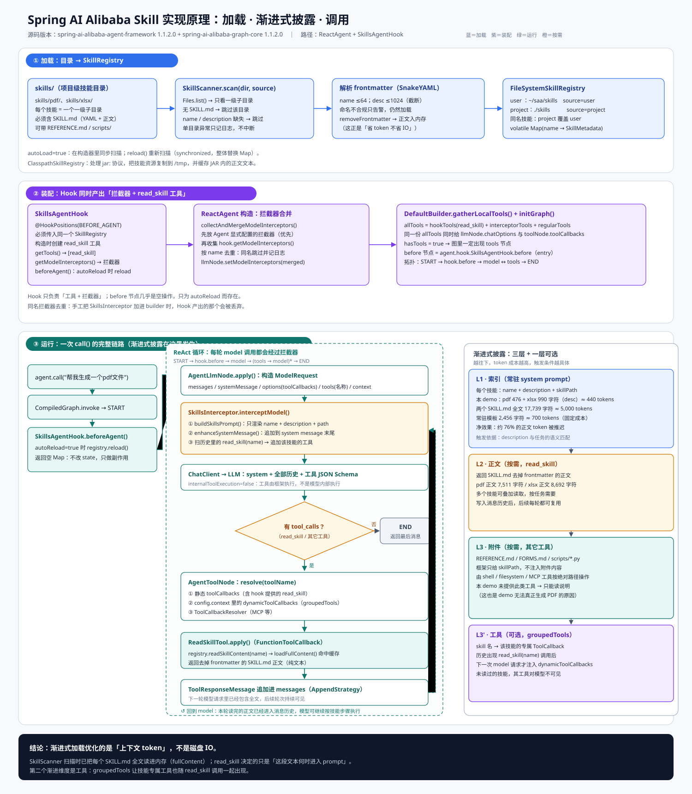

# Spring AI Alibaba Skill 实现原理（源码级分析）

> **分析对象**：`com.alibaba.cloud.ai:spring-ai-alibaba-agent-framework:1.1.2.0` + `com.alibaba.cloud.ai:spring-ai-alibaba-graph-core:1.1.2.0`
>
> **源码来源**：本地 Maven 仓库中的 `-sources.jar` 解压后按需保留，位于 [`sources/`](sources)（只保留 Skill 相关的类，便于对照行号）。
>
> **配套流程图**：[`skill-flow.svg`](skill-flow.svg)（整体链路一张图，用浏览器 / IDEA 直接打开）。
>
> **分析路径**：本项目 `SkillDemo` 使用的 `ReactAgent + SkillsAgentHook` 路径（另一条 `ChatClient + Advisor` 路径在第 2.3 节对比）。

---

## 0. 先给结论

1. **Skill 不是类、不是 Bean、不是 SPI**。一个 Skill 就是一个目录：里面必须有 `SKILL.md`，YAML frontmatter 提供 `name` / `description`，Markdown 正文就是给模型看的操作手册，目录下还可以带脚本、参考资料等附件。框架只认目录结构，不做代码注册。
2. **"加载"分两层含义**：
   - **注册表加载（一次）**：`SkillRegistry` 扫描目录，把每个技能的 `name + description + 路径`（以及正文文本）装进一个 `Map`；
   - **上下文加载（渐进式）**：真正送进 LLM 的，默认只有 `name + description + 路径` 这份"目录索引"；`SKILL.md` 正文要等模型主动调用 `read_skill` 才进入上下文。
3. **渐进式加载的本质是"提示词工程 + 工具设计"**，不是懒加载类加载器。`SkillScanner` 在扫描阶段其实已经把每个 `SKILL.md` 的**全文读进了内存**（`fullContent`），渐进式省的是 **prompt token**，不是磁盘 IO。
4. **调用链**：模型在 system prompt 里看到技能索引 → 判断相关 → 输出 `read_skill(skill_name)` 工具调用 → `AgentToolNode` 解析并执行 `ReadSkillTool` → 返回去掉 frontmatter 的正文 → `ToolResponseMessage` 追加进消息历史 → 下一轮模型就能看到全文。全程由模型自主决策，框架不做语义路由。
5. 本项目在标准机制之上还有一层 **"工具渐进披露"**：`SkillsAgentHook.groupedTools` 可以把"技能专属工具"绑定到技能名，只有历史里出现过该技能的 `read_skill` 调用后，这些工具才会被 `SkillsInterceptor` 动态塞进下一次模型请求（`dynamicToolCallbacks`）。

一句话总结：

> **目录即技能，索引进提示词，正文按需拉取，附件按需读取，工具按需挂载。**

---

## 1. Skill 的物理形态

### 1.1 目录结构

本仓库的 [`skills/`](skills) 下有两个示例技能：

```text
skills/
├── pdf/
│   ├── SKILL.md          ← 必须有；frontmatter + 正文
│   ├── REFERENCE.md      ← 附件：参考资料
│   ├── FORMS.md          ← 附件：表单处理指南
│   ├── LICENSE.txt
│   └── scripts/*.py      ← 附件：可执行脚本
└── xlsx/
    ├── SKILL.md
    ├── LICENSE.txt
    └── scripts/...
```

`SKILL.md` 的开头（真实内容，见 [`skills/pdf/SKILL.md`](skills/pdf/SKILL.md)）：

```markdown
---
name: pdf
description: Use this skill whenever the user wants to do anything with PDF files. ...
license: Complete terms in LICENSE.txt
---

# PDF Processing Guide

## Overview
...
```

### 1.2 框架关心的字段

| frontmatter 字段 | 是否必填 | 框架行为 | 代码位置 |
|---|---|---|---|
| `name` | 必填 | 作为 Registry 的 key，也是 `read_skill` 的参数值 | [SkillScanner.java:118](sources/graph-core/com/alibaba/cloud/ai/graph/skills/registry/filesystem/SkillScanner.java#L118) |
| `description` | 必填 | 注入 L1 索引，是模型判断"用不用这个技能"的唯一依据；超过 1024 字符截断 | [SkillScanner.java:126](sources/graph-core/com/alibaba/cloud/ai/graph/skills/registry/filesystem/SkillScanner.java#L126)、[137](sources/graph-core/com/alibaba/cloud/ai/graph/skills/registry/filesystem/SkillScanner.java#L137) |
| `license` | 可选 | **完全忽略**，不进入任何 prompt | — |
| 其它字段 | 可选 | 忽略 | — |
| Markdown 正文 | 可选（但没意义） | 扫描时读入 `fullContent`，`read_skill` 时返回 | [SkillScanner.java:147](sources/graph-core/com/alibaba/cloud/ai/graph/skills/registry/filesystem/SkillScanner.java#L147) |

`SkillMetadata` 只有 5 个字段（[SkillMetadata.java:28](sources/graph-core/com/alibaba/cloud/ai/graph/skills/SkillMetadata.java#L28)）：

| 字段 | 含义 | 是否进入 L1 prompt |
|---|---|---|
| `name` | 技能名 | 是 |
| `description` | 技能说明 | 是 |
| `skillPath` | 技能目录**绝对路径** | 是（给模型拼接附件路径用） |
| `source` | `user` / `project` / `classpath` | 决定 prompt 分组 |
| `fullContent` | 去掉 frontmatter 后的正文，扫描时缓存 | **否**（只有 `read_skill` 才返回） |

### 1.3 Skill 与 Tool 的区别

| 维度 | Tool（`ToolCallback`） | Skill |
|---|---|---|
| 本质 | 可执行函数 + JSON Schema | 一段给模型看的指令文本 + 附件 |
| 谁执行 | 框架（`AgentToolNode`） | 模型读完自己照做；附件由其它工具执行 |
| 注册方式 | `FunctionToolCallback` / `@Tool` / MCP | 放目录里，Registry 扫描 |
| 是否常驻上下文 | 工具 schema 常驻 | 只有索引常驻，正文按需 |
| 适合场景 | 确定性动作（查天气、查库） | 复杂流程、领域知识、多步骤作业规范 |

---

## 2. 代码地图

### 2.1 分层

```text
graph-core（协议层：技能是什么、怎么存、怎么渲染提示词）
└── com.alibaba.cloud.ai.graph.skills
    ├── SkillMetadata                    技能元数据（含 fullContent 缓存）
    ├── SkillPromptConstants             {skills_list} + {skills_load_instructions} 渲染
    ├── registry.SkillRegistry           注册表接口（get/listAll/readSkillContent/...）
    ├── registry.AbstractSkillRegistry   volatile Map + synchronized reload
    ├── registry.filesystem.SkillScanner 目录扫描 + frontmatter 解析
    ├── registry.filesystem.FileSystemSkillRegistry  user/project 双目录 + 覆盖合并
    ├── registry.classpath.ClasspathSkillRegistry    classpath（含 JAR）支持
    ├── SpringAiSkillAdvisor             ChatClient 路径（BaseAdvisor）
    └── advisors.SkillPromptAugmentAdvisor 同上，近似重复实现

agent-framework（接入层：挂到 ReActAgent 上）
└── com.alibaba.cloud.ai.graph.agent
    ├── hook.skills.SkillsAgentHook      BEFORE_AGENT 钩子：装配工具 + 拦截器
    ├── hook.skills.ReadSkillTool        read_skill 工具实现
    ├── interceptor.skills.SkillsInterceptor  每次模型调用注入索引 + 动态工具
    ├── ReactAgent / DefaultBuilder      合并 hook 的拦截器与工具
    ├── node.AgentLlmNode                ModelRequest → 拦截器链 → ChatClient
    └── node.AgentToolNode               工具解析与执行
```

### 2.2 类职责表

| 类 | 模块 | 核心职责 |
|---|---|---|
| [`SkillRegistry`](sources/graph-core/com/alibaba/cloud/ai/graph/skills/registry/SkillRegistry.java#L36) | graph-core | 只读接口：`get` / `listAll` / `contains` / `size` / `reload` / `readSkillContent` / `getSkillLoadInstructions` / `getRegistryType` / `getSystemPromptTemplate` |
| [`AbstractSkillRegistry`](sources/graph-core/com/alibaba/cloud/ai/graph/skills/registry/AbstractSkillRegistry.java#L29) | graph-core | `volatile Map<String, SkillMetadata>`；`reload()` 加 `synchronized`；其余方法都是读 |
| [`SkillScanner`](sources/graph-core/com/alibaba/cloud/ai/graph/skills/registry/filesystem/SkillScanner.java#L43) | graph-core | 列目录、读 `SKILL.md`、解析 YAML、校验、截断、去 frontmatter |
| [`FileSystemSkillRegistry`](sources/graph-core/com/alibaba/cloud/ai/graph/skills/registry/filesystem/FileSystemSkillRegistry.java#L65) | graph-core | 默认 `~/saa/skills` + `./skills`，project 覆盖 user |
| [`ClasspathSkillRegistry`](sources/graph-core/com/alibaba/cloud/ai/graph/skills/registry/classpath/ClasspathSkillRegistry.java#L71) | graph-core | `classpath:skills`，兼容 JAR，资源复制到 `/tmp` |
| [`SkillPromptConstants`](sources/graph-core/com/alibaba/cloud/ai/graph/skills/SkillPromptConstants.java#L27) | graph-core | 把技能列表 + 加载说明塞进模板变量并渲染 |
| [`SkillsAgentHook`](sources/agent-framework/com/alibaba/cloud/ai/graph/agent/hook/skills/SkillsAgentHook.java#L75) | agent-framework | 一个 Hook 同时产出 `read_skill` 工具和 `SkillsInterceptor` |
| [`ReadSkillTool`](sources/agent-framework/com/alibaba/cloud/ai/graph/agent/hook/skills/ReadSkillTool.java#L38) | agent-framework | `BiFunction<ReadSkillRequest, ToolContext, String>`，按 name 取正文 |
| [`SkillsInterceptor`](sources/agent-framework/com/alibaba/cloud/ai/graph/agent/interceptor/skills/SkillsInterceptor.java#L94) | agent-framework | 每轮模型调用：拼索引、改 system message、注入动态工具 |
| [`SpringAiSkillAdvisor`](sources/graph-core/com/alibaba/cloud/ai/graph/skills/SpringAiSkillAdvisor.java#L54) | graph-core | 给裸 `ChatClient` 用的 Advisor，只做提示词注入 |

### 2.3 两条接入路径（重要）

| | ChatClient + Advisor | ReactAgent + Hook（本项目） |
|---|---|---|
| 入口类 | `SpringAiSkillAdvisor` / `SkillPromptAugmentAdvisor` | `SkillsAgentHook` |
| 提示词注入点 | Spring AI `BaseAdvisor.before()` | `ModelInterceptor.interceptModel()` |
| `read_skill` 工具 | **不会自动注册**（需要自己加 `ReadSkillTool.createReadSkillToolCallback(...)`） | 自动注册（`hook.getTools()`） |
| 动态工具披露 | 不支持 | 支持（`groupedTools`） |
| 重新扫描时机 | `before()` 里每轮都 `reload()` | 构造时一次；`autoReload=true` 时每轮 |
| 适用 | 简单 ChatClient | 需要工具循环 / 多轮 ReAct 的 Agent |

> 注意：`SpringAiSkillAdvisor` 的 javadoc 写着 "LLM reads full SKILL.md content when needed using `read_skill` tool"，但它本身**没有注册该工具**。走 Advisor 路径时，模型会看到"请调用 read_skill"的指令却无此工具可用，必须手动把 `ReadSkillTool` 的 `ToolCallback` 加进 `ChatClient` 的 `toolCallbacks`。

---

## 3. 加载：从磁盘到 Registry

### 3.1 装配入口

本项目的 [`SkillDemo.java`](src/main/java/edu/whpu/SkillDemo.java)：

```java
SkillRegistry registry = FileSystemSkillRegistry.builder()
        .projectSkillsDirectory(Path.of("skills").toAbsolutePath().toString())
        .build();

SkillsAgentHook hook = SkillsAgentHook.builder()
        .skillRegistry(registry)
        .build();

ReactAgent agent = ReactAgent.builder()
        .name("skills-agent")
        .model(chatModel)
        .saver(new MemorySaver())
        .hooks(List.of(hook))
        .build();
```

三件事都是**显式**的：

1. 先建 Registry（此时已经完成目录扫描）；
2. 再建 Hook（此时创建 `read_skill` 工具）；
3. 最后把 Hook 交给 `ReactAgent.builder().hooks(...)`。**不传 hooks 就没有任何技能能力**，框架不会自动发现 `skills/` 目录。

### 3.2 构造器里的"自动加载"

[`FileSystemSkillRegistry` 构造器](sources/graph-core/com/alibaba/cloud/ai/graph/skills/registry/filesystem/FileSystemSkillRegistry.java#L137)：

```java
// user 默认 ~/saa/skills
this.userSkillsDirectory = System.getProperty("user.home") + "/saa/skills";
// project 默认 <cwd>/skills
this.projectSkillsDirectory = Path.of("").toAbsolutePath().resolve("skills").toString();
...
if (builder.autoLoad) {
    loadSkillsToRegistry();      // 构造即扫描（同步）
}
```

- `autoLoad` 默认 `true`（[Builder:328](sources/graph-core/com/alibaba/cloud/ai/graph/skills/registry/filesystem/FileSystemSkillRegistry.java#L328)）；
- 也就是说 `builder().build()` 返回时，`registry.listAll()` 已经可用；
- 扫描失败不抛异常，只打日志，得到一个可能为空的注册表。

### 3.3 扫描过程（`SkillScanner`）

#### (1) 只扫一层子目录

[`scan(dir, source)`](sources/graph-core/com/alibaba/cloud/ai/graph/skills/registry/filesystem/SkillScanner.java#L60)：

```java
try (Stream<Path> paths = Files.list(skillsPath)) {     // 只看一级
    paths.filter(Files::isDirectory)                     // 只认目录
         .forEach(skillDir -> {
             SkillMetadata metadata = loadSkill(skillDir, source);
             if (metadata != null) skills.add(metadata);
         });
}
```

推论：`skills/foo/bar/SKILL.md` 这种嵌套结构**不会被发现**；`skills/` 根目录下的散装 `*.md` 也不会。

#### (2) 每个目录必须有 `SKILL.md`

[`loadSkill`](sources/graph-core/com/alibaba/cloud/ai/graph/skills/registry/filesystem/SkillScanner.java#L101)：

```java
Path skillFile = skillDir.resolve("SKILL.md");
if (!Files.exists(skillFile)) return null;

String content = Files.readString(skillFile);      // 全文读入
Map<String, Object> frontmatter = parseFrontmatter(content);
...
String name = (String) frontmatter.get("name");
String description = (String) frontmatter.get("description");
if (name == null || name.isEmpty()) return null;
if (description == null || description.isEmpty()) return null;
```

#### (3) frontmatter 解析是"字符串切分 + SnakeYAML"

[`parseFrontmatter`](sources/graph-core/com/alibaba/cloud/ai/graph/skills/registry/filesystem/SkillScanner.java#L220)：

```java
if (!content.startsWith("---")) return null;
int endIndex = content.indexOf("---", 3);     // 找第二个 ---
if (endIndex == -1) return null;
String frontmatterStr = content.substring(3, endIndex).trim();
return yaml.load(frontmatterStr);
```

没有用 Markdown 解析库，纯文本定位。优点是零依赖、快；缺点是正文里如果出现 `---` 且 frontmatter 不闭合，会切错（见第 6 节坑位）。

#### (4) 校验：只告警，不拒绝

[`validateSkillName`](sources/graph-core/com/alibaba/cloud/ai/graph/skills/registry/filesystem/SkillScanner.java#L185) 按 Agent Skills 规范检查：

- 长度 ≤ 64；
- 必须匹配 `^[a-z0-9]+(-[a-z0-9]+)*$`（小写字母/数字，单连字符，首尾不能是连字符）；
- 必须和**父目录名一致**。

但三个检查全部只 `logger.warn(...)`，**仍然加载**（注释明确写了 "warn but still load for backwards compatibility"）。只有 `name`/`description` 缺失才会 `return null`。

`description` 超长则直接硬截断（[137-143](sources/graph-core/com/alibaba/cloud/ai/graph/skills/registry/filesystem/SkillScanner.java#L137)）：

```java
if (descriptionStr.length() > 1024) {
    descriptionStr = descriptionStr.substring(0, 1024);
}
```

#### (5) 正文随元数据一起缓存

```java
SkillMetadata.builder()
    .name(name)
    .description(descriptionStr)
    .skillPath(skillDir.toString())      // 绝对路径
    .source(source)
    .fullContent(removeFrontmatter(content))   // ← 全文此刻已进内存
    .build();
```

**这就是理解"渐进式加载"的关键**：扫描阶段没有做任何"只读元数据、正文留到以后"的优化；`fullContent` 一开始就在 `SkillMetadata` 里。渐进式只发生在**提示词组装**时。

### 3.4 合并与覆盖

[`loadSkillsToRegistry`](sources/graph-core/com/alibaba/cloud/ai/graph/skills/registry/filesystem/FileSystemSkillRegistry.java#L179)：

```java
Map<String, SkillMetadata> mergedSkills = new HashMap<>();

for (skill : scanner.scan(userSkillsDirectory, "user"))
    mergedSkills.put(skill.getName(), skill);        // 先 user

for (skill : scanner.scan(projectSkillsDirectory, "project"))
    mergedSkills.put(skill.getName(), skill);        // 后 project → 同名覆盖

this.skills = mergedSkills;                          // 整体替换（volatile 写）
```

- 覆盖维度是 `name`，不是目录名；
- 没有命名空间/前缀，两个技能同名就是后写赢；
- 同一个目录里两个子目录声明了相同 `name` 时，谁赢取决于 `Files.list` 的返回顺序（不可依赖）。

### 3.5 Classpath 变体

[`ClasspathSkillRegistry`](sources/graph-core/com/alibaba/cloud/ai/graph/skills/registry/classpath/ClasspathSkillRegistry.java#L127) 解决"技能打包进 JAR"的问题：

1. `getResource("skills")` → `file:` 协议直接当文件系统路径；
2. `jar:` 协议则 `FileSystems.newFileSystem(uri, ...)` 打开 JAR；
3. 不管哪种，都把技能资源**复制到 `/tmp/skills/<name>/`**，并把 `skillPath` 改成复制后的路径（[236-241](sources/graph-core/com/alibaba/cloud/ai/graph/skills/registry/classpath/ClasspathSkillRegistry.java#L236)）——这样模型拿到的绝对路径在运行期真实可读；
4. JAR 内文本额外缓存在 `jarSkillContentCache`，因为 `Path.of()` 访问不了 JAR 内路径（[421-442](sources/graph-core/com/alibaba/cloud/ai/graph/skills/registry/classpath/ClasspathSkillRegistry.java#L421)）。

> 细节：`ClasspathSkillRegistry` 复用了 `FileSystemSkillRegistry.DEFAULT_SYSTEM_PROMPT_TEMPLATE`，而该模板里硬编码了 "file system based storage" / "file system based Skill Registry"。走 classpath 时提示词与实际存储类型不一致（无害但会误导模型）。

### 3.6 三个"加载开关"别混淆

| 开关 | 位置 | 默认 | 作用 | 代价 |
|---|---|---|---|---|
| `autoLoad` | `FileSystemSkillRegistry.Builder` / `ClasspathSkillRegistry.Builder` | `true` | 构造时同步扫描一次 | 启动期一次 IO |
| `reload()` | `SkillRegistry` 接口 | — | 重新扫描并整体替换 Map（`synchronized`） | 每次全量 IO |
| `autoReload` | `SkillsAgentHook.Builder` | `false` | 每次 agent 调用前 `beforeAgent` 里 reload | 每轮全量 IO |
| `lazyLoad` | `SpringAiSkillAdvisor.Builder` | `false` | 只是让 Registry 构造时不扫描 | **`before()` 里仍然每次 `reload()`**（[119-123](sources/graph-core/com/alibaba/cloud/ai/graph/skills/SpringAiSkillAdvisor.java#L119)），所以实际是"每次都扫" |

### 3.7 加载时序

```text
SkillDemo.main
   │
   ├─ FileSystemSkillRegistry.builder().projectSkillsDirectory(".../skills").build()
   │     └─ new FileSystemSkillRegistry(builder)
   │           ├─ userDir   = ~/saa/skills        (若未配置)
   │           ├─ projectDir= <cwd>/skills        (未配置时)
   │           ├─ systemPromptTemplate = DEFAULT_SYSTEM_PROMPT_TEMPLATE
   │           └─ autoLoad → loadSkillsToRegistry()
   │                 ├─ Files.exists(~/saa/skills)?  → scan(dir,"user")
   │                 │     └─ 每个子目录 → loadSkill
   │                 │           ├─ Files.readString(SKILL.md)
   │                 │           ├─ parseFrontmatter (SnakeYAML)
   │                 │           ├─ 校验 name / 截断 description
   │                 │           └─ removeFrontmatter → fullContent
   │                 ├─ Files.exists(./skills)?      → scan(dir,"project")
   │                 └─ mergedSkills.put(...) × N  → this.skills = mergedSkills
   │
   └─ SkillsAgentHook.builder().skillRegistry(registry).build()
         └─ this.readSkillTool = FunctionToolCallback.builder("read_skill", ...)
```

### 3.8 这一阶段的成本与线程安全

- **成本**：O(技能数) 次目录项读取 + 每个 `SKILL.md` 一次全文 `readString`；技能附件（如 200 KB 的 `.xsd`）**不会**被读，只有 `SKILL.md` 会被读。
- **线程安全模型**：
  - `skills` 是 `volatile` 引用（[AbstractSkillRegistry:32](sources/graph-core/com/alibaba/cloud/ai/graph/skills/registry/AbstractSkillRegistry.java#L32)），reload 时先构建新 `HashMap` 再整体替换，读者要么看到旧表、要么看到新表，不会看到半个表；
  - `reload()` 是 `synchronized` 实例方法，串行化并发 reload；
  - 加载完成后 Map 不再被修改，因此 `get`/`listAll` 无需加锁。
- **一个小竞态**：`SkillMetadata.loadFullContent()` 的 `fullContent` 字段**不是 volatile**（[83-94](sources/graph-core/com/alibaba/cloud/ai/graph/skills/SkillMetadata.java#L83)）。若元数据是手工构造且未预填 `fullContent`，并发首次读可能各自读一次文件——结果正确，只是多一次 IO。

---

## 4. 渐进式加载：三层披露 + 一层可选

### 4.1 为什么需要：先算 token

用本仓库真实数据（字符数，按 3.5–4 字符/token 粗估）：

| 内容 | 字符数 | 估算 token | 何时进入上下文 |
|---|---|---|---|
| `pdf/SKILL.md` 全文 | 8,021（frontmatter 499 + 正文 7,511） | ≈ 2,000–2,300 | `read_skill` 时 |
| `xlsx/SKILL.md` 全文 | 9,718（frontmatter 1,015 + 正文 8,692） | ≈ 2,400–2,800 | `read_skill` 时 |
| 两个技能的 L1 索引（name + desc + path） | ≈ 1,700 | ≈ 430–480 | **每轮** |
| `DEFAULT_SYSTEM_PROMPT_TEMPLATE` | 2,456 | ≈ 600–700 | **每轮** |
| **L1 合计** | ≈ 4,200 | ≈ 1,000–1,200 | 每轮 |
| **两个技能全文合计** | 17,739 | ≈ 4,400–5,100 | 按需 |

也就是说：**常驻成本约为全文的 20%，80% 的正文 token 被推迟到真正需要时**。技能越多、正文越长，收益越明显；但要注意两笔固定成本：

1. **模板本身**约 2.4k 字符，技能很少时它反而占大头；
2. **description 上限 1024 字符**，50 个技能最坏情况就是 5 万字符的索引——索引不是免费的，`description` 必须写得克制。

### 4.2 L1：索引是怎么被塞进 system prompt 的

这不是一处代码完成的，而是一条装配链：

```text
SkillsAgentHook（构造时）
   ├─ getTools()             → [ read_skill ToolCallback ]
   └─ getModelInterceptors() → [ SkillsInterceptor(共享 registry) ]
                 │
ReactAgent 构造（collectAndMergeModelInterceptors）
   └─ llmNode.setModelInterceptors([... SkillsInterceptor ...])
                 │
DefaultBuilder.gatherLocalTools
   └─ allTools = hookTools(read_skill) + interceptorTools + regularTools
         ├─ llmNode.chatOptions.toolCallbacks   （模型能看到 read_skill 的 schema）
         └─ toolNode.toolCallbacks             （运行期能执行 read_skill）
                 │
ReactAgent.initGraph
   └─ @HookPositions(BEFORE_AGENT) → 节点 "agent.hook.SkillsAgentHook.before" → entry node
```

#### (1) Hook 是一个"装配器"，图节点几乎是空操作

[`SkillsAgentHook`](sources/agent-framework/com/alibaba/cloud/ai/graph/agent/hook/skills/SkillsAgentHook.java#L85)：

```java
@HookPositions(HookPosition.BEFORE_AGENT)
public class SkillsAgentHook extends AgentHook {
    private final ToolCallback readSkillTool;

    private SkillsAgentHook(Builder builder) {
        this.skillRegistry = builder.skillRegistry;
        this.readSkillTool = ReadSkillTool.createReadSkillToolCallback(
                this.skillRegistry, ReadSkillTool.DESCRIPTION);
    }

    @Override
    public CompletableFuture<Map<String, Object>> beforeAgent(OverAllState state, RunnableConfig config) {
        if (autoReload) {
            skillRegistry.reload();          // 默认 false
        }
        return CompletableFuture.completedFuture(Map.of());   // 不改 state
    }

    @Override public List<ModelInterceptor> getModelInterceptors() {
        return List.of(SkillsInterceptor.builder()
                .skillRegistry(skillRegistry)
                .groupedTools(groupedTools)
                .build());
    }

    @Override public List<ToolCallback> getTools() {
        return List.of(readSkillTool);
    }
}
```

设计含义：

- `beforeAgent` 返回空 Map，说明**它不负责注入提示词**，只负责可选的 reload；
- 真正的注入发生在 `SkillsInterceptor.interceptModel`，也就是**每次模型调用**；
- `getTools()` 无条件返回 `read_skill`，即使注册表为空、即使没有任何技能，这个工具都挂在模型上（配合拦截器的空表短路，模型只会看到一个"没有目标"的工具）。

#### (2) ReactAgent 如何合并拦截器

[`ReactAgent` 构造器](sources/agent-framework/com/alibaba/cloud/ai/graph/agent/ReactAgent.java#L142)：

```java
List<ModelInterceptor> mergedModelInterceptors = collectAndMergeModelInterceptors();
List<ToolInterceptor> mergedToolInterceptors = collectAndMergeToolInterceptors();
if (!mergedModelInterceptors.isEmpty()) this.llmNode.setModelInterceptors(mergedModelInterceptors);
```

[`collectAndMergeModelInterceptors`](sources/agent-framework/com/alibaba/cloud/ai/graph/agent/ReactAgent.java#L868) 的规则：

1. 先放 `builder.modelInterceptors`（用户显式配置，优先级高）；
2. 再遍历 `hooks`，逐个 `hook.getModelInterceptors()`；
3. 用 `interceptor.getName()`（默认是简单类名 `SkillsInterceptor`）去重，重名跳过并打日志。

这条规则很关键：如果你手工把 `SkillsInterceptor` 也加进 `builder`，Hook 产出的那个会被丢弃——两者功能相同，但**手工那个必须自己保证 registry 是同一个实例**。

#### (3) 工具如何进入模型与工具节点

[`DefaultBuilder.gatherLocalTools`](sources/agent-framework/com/alibaba/cloud/ai/graph/agent/DefaultBuilder.java#L268)：

```java
// hook 提供的工具
for (Hook hook : hooks) hookTools.addAll(hook.getTools());
// 拦截器提供的工具
interceptorTools = modelInterceptors.stream().flatMap(i -> i.getTools().stream()).toList();
// builder.tools(...) / 解析出来的工具
regularTools = ...
List<ToolCallback> allTools = hookTools + interceptorTools + regularTools;
```

然后同一份 `allTools` 同时给 `llmNode`（[128](sources/agent-framework/com/alibaba/cloud/ai/graph/agent/DefaultBuilder.java#L128)）和 `toolNode`（[150](sources/agent-framework/com/alibaba/cloud/ai/graph/agent/DefaultBuilder.java#L150)），并且：

```java
hasTools = toolNode.getToolCallbacks() != null && !toolNode.getToolCallbacks().isEmpty();
```

所以**只要挂了 `SkillsAgentHook`，即使你没有配置任何工具，图里也一定会有 tools 节点**（因为 `read_skill` 在）。

#### (4) 图拓扑里 Hook 的位置

[`ReactAgent.initGraph`](sources/agent-framework/com/alibaba/cloud/ai/graph/agent/ReactAgent.java#L333) 按 `@HookPositions` 把 Hook 分成 4 类，并为 `BEFORE_AGENT` 的 Hook 建节点：

```java
for (Hook hook : beforeAgentHooks) {
    if (hook instanceof AgentHook agentHook) {
        graph.addNode(Hook.getFullHookName(hook) + ".before", agentHook::beforeAgent);
    }
}
String entryNode = determineEntryNode(beforeAgentHooks, beforeModelHooks);  // 第一个 before 节点
graph.addEdge(START, entryNode);
```

`SkillsAgentHook` 只声明了 `BEFORE_AGENT`（[75](sources/agent-framework/com/alibaba/cloud/ai/graph/agent/hook/skills/SkillsAgentHook.java#L75)），不会生成 `.after` 节点，也不影响 `model ⇄ tools` 循环内部。最终拓扑：

```text
START → agent.hook.SkillsAgentHook.before → agent.model ⇄ agent.tool → END
                                             （model 节点内套拦截器链）
```

#### (5) 每轮模型请求：`SkillsInterceptor.interceptModel`

[`SkillsInterceptor`](sources/agent-framework/com/alibaba/cloud/ai/graph/agent/interceptor/skills/SkillsInterceptor.java#L117)：

```java
public ModelResponse interceptModel(ModelRequest request, ModelCallHandler handler) {
    List<SkillMetadata> skills = skillRegistry.listAll();
    if (skills.isEmpty()) return handler.call(request);        // 无技能：零开销透传

    // 1. 从历史消息里找出所有 read_skill(skill_name) 调用
    Set<String> readSkillNames = extractReadSkillNames(request.getMessages());

    // 2. 把这些技能对应的工具追加到 dynamicToolCallbacks
    List<ToolCallback> skillTools = new ArrayList<>(request.getDynamicToolCallbacks());
    for (String skillName : readSkillNames) {
        List<ToolCallback> toolsForSkill = grouped.get(skillName);
        if (toolsForSkill != null) skillTools.addAll(toolsForSkill);
    }

    // 3. 渲染 L1 索引并追加到 system message
    String skillsPrompt = buildSkillsPrompt(skills, skillRegistry, skillRegistry.getSystemPromptTemplate());
    SystemMessage enhanced = enhanceSystemMessage(request.getSystemMessage(), skillsPrompt);

    // 4. 用修改后的请求继续责任链
    ModelRequest modified = ModelRequest.builder(request)
            .systemMessage(enhanced)
            .dynamicToolCallbacks(skillTools)
            .build();
    return handler.call(modified);
}
```

`enhanceSystemMessage` 是简单拼接（[210-215](sources/agent-framework/com/alibaba/cloud/ai/graph/agent/interceptor/skills/SkillsInterceptor.java#L210)）：

```java
if (existing == null) return new SystemMessage(skillsSection);
return new SystemMessage(existing.getText() + "\n\n" + skillsSection);
```

所以：**没有 systemPrompt 的 Agent，技能段会直接成为 system prompt；有 systemPrompt 的，技能段追加在末尾。**

#### (6) 索引文本长什么样

[`SkillPromptConstants.buildSkillsPrompt`](sources/graph-core/com/alibaba/cloud/ai/graph/skills/SkillPromptConstants.java#L41)：

```java
for (SkillMetadata skill : skills) {
    if ("project".equals(skill.getSource())) projectSkills.add(skill);
    else userSkills.add(skill);
}
// 每个技能渲染为两行：
// - **{name}**: {description}
//   → Supporting files ... are located at directory `{skillPath}`, use this path to form the absolute path ...
context.put("skills_list", skillList.toString());
context.put("skills_load_instructions", skillRegistry.getSkillLoadInstructions());
return systemPromptTemplate.render(context);
```

本项目两个技能都是 `project` 级，实际渲染（节选示意）：

```markdown
## Skills System

You have access to a skills library that provides specialized capabilities and domain knowledge.
All skills are stored in a Skill Registry with a file system based storage.

### Available Skills

**Project Skills:**
- **pdf**: Use this skill whenever the user wants to do anything with PDF files. ...
  → Supporting files that skill uses (scripts, references, etc.) are located at directory `D:\...\skills\pdf`, use this path to form the absolute path when reading supporting files.
- **xlsx**: Use this skill any time a spreadsheet file is the primary input or output. ...
  → Supporting files ... `D:\...\skills\xlsx` ...

### How to Use Skills (Progressive Disclosure)

Skills follow a **progressive disclosure** pattern - you know they exist (name + description above),
but you only read the full instructions when needed:

1. **Recognize when a skill applies**: Check if the user's task matches any skill's description
2. **Read the skill's full instructions**: ... use `read_skill`
3. **Follow the skill's instructions**: SKILL.md contains step-by-step workflows, best practices, and examples
4. **Access supporting files**: ... use absolute paths

...
**Important:**
  - For SKILL.md files (skill instructions): Always use `read_skill` ...
  - For other supporting files ...: You may use other appropriate tools ... always use absolute paths
```

模板全文见 [`FileSystemSkillRegistry.DEFAULT_SYSTEM_PROMPT_TEMPLATE`](sources/graph-core/com/alibaba/cloud/ai/graph/skills/registry/filesystem/FileSystemSkillRegistry.java#L75)。这段提示词承担了"路由"职责：它告诉模型**什么时候该读、用哪个工具读、附件怎么找**，但没有强制力。

### 4.3 L2：正文按需（`read_skill`）

工具定义（[ReadSkillTool.java:66](sources/agent-framework/com/alibaba/cloud/ai/graph/agent/hook/skills/ReadSkillTool.java#L66)）：

```java
FunctionToolCallback.builder("read_skill", new ReadSkillTool(skillRegistry))
    .description("Reads the full content of a skill from the SkillRegistry. ...")
    .inputType(ReadSkillRequest.class)      // {"skill_name": string} required
    .build();
```

执行（[74-99](sources/agent-framework/com/alibaba/cloud/ai/graph/agent/hook/skills/ReadSkillTool.java#L74)）：

```java
String content = skillRegistry.readSkillContent(request.skillName);
return content;
// 异常一律转成 "Error: ..." 字符串返回，让模型有机会自我纠正
```

`FileSystemSkillRegistry.readSkillContent`（[233-248](sources/graph-core/com/alibaba/cloud/ai/graph/skills/registry/filesystem/FileSystemSkillRegistry.java#L233)）：

```java
Optional<SkillMetadata> skillOpt = get(name);
if (skillOpt.isEmpty()) throw new IllegalStateException("Skill not found: " + name);
return skill.loadFullContent();     // 命中扫描阶段缓存的 fullContent
```

返回的是**去掉 frontmatter 的正文**（扫描时已去掉，`loadFullContent` 只在 `fullContent == null` 时才回读磁盘）。

### 4.4 L3：附件按需

框架**不注入、也不读取**附件。它只做一件事：在 L1 索引里给出 `skillPath`，并明确要求模型"用绝对路径"。

谁来完成读取/执行？取决于你给 Agent 配了什么工具：

| 附件类型 | 需要的工具 | 本仓库可用的实现 |
|---|---|---|
| `REFERENCE.md` / `FORMS.md` | 文件读取工具 | `FilesystemInterceptor`（extension 包）或自建 |
| `scripts/*.py` | Shell / 代码执行工具 | `ShellToolAgentHook`（`hook/shelltool`） |
| 外部系统 | MCP 工具 | MCP 集成 |

> 本项目 `SkillDemo` **只挂了 `SkillsAgentHook`**，没有文件/Shell 工具。所以模型即使读完 `pdf/SKILL.md`，也**没有能力**真正生成 PDF 或执行 `scripts/fill_pdf_form_with_annotations.py`。这是 demo 的完整性缺口，不是 Skill 机制本身的缺口。

### 4.5 L3'：工具按需（本项目增强）

`groupedTools` 把"技能"和"该技能专属的工具"绑定：

```java
Map<String, List<ToolCallback>> grouped = Map.of(
    "xlsx", List.of(excelWriteTool),
    "pdf",  List.of(pdfFillTool)
);
SkillsAgentHook hook = SkillsAgentHook.builder()
    .skillRegistry(registry)
    .groupedTools(grouped)
    .build();
```

生效方式在 [`extractReadSkillNames`](sources/agent-framework/com/alibaba/cloud/ai/graph/agent/interceptor/skills/SkillsInterceptor.java#L160)：

```java
for (Message message : messages) {
    if (!(message instanceof AssistantMessage am) || !am.hasToolCalls()) continue;
    for (AssistantMessage.ToolCall toolCall : am.getToolCalls()) {
        if (!ReadSkillTool.READ_SKILL.equals(toolCall.name())) continue;
        String skillName = parseSkillNameFromArguments(toolCall.arguments());  // JsonParser → Map → "skill_name"
        if (skillName != null) names.add(skillName);
    }
}
```

特点与边界：

- 触发条件是**历史里存在** `read_skill(name)` 的 AssistantMessage，不是"本轮刚刚调用"；
- 因为消息历史会累积，一旦读过某个技能，**同一线程后续每一轮**都会再次注入该技能的工具（直到历史被裁剪）；
- 参数解析是宽松的：`arguments` 是 JSON 字符串，解析失败就忽略，不会报错；
- 注入的工具进入 `ModelRequest.dynamicToolCallbacks`，由 `AgentLlmNode` 合并进 `ChatOptions`，同时写入 `RunnableConfig.context()`，供 `AgentToolNode` 在真正执行时找回（见 5.4）；
- 注入发生在 `SkillsInterceptor` 里，早于模型调用，因此**模型在这一轮就能看到并调用新工具**。

### 4.6 关键结论：省的是 token，不是 IO

```text
磁盘 ──(启动/ reload，一次性全读)──> SkillMetadata.fullContent（内存）
                                          │
                          ┌───────────────┴────────────────┐
                          │                                │
                   L1: name+desc+path               L2: 正文
                   （每轮都进 prompt）            （read_skill 才进 prompt）
```

- 如果你想省内存，需要自己改 `SkillScanner`（把 `fullContent` 置空、`loadFullContent` 时再读）；
- 如果你想省 token，当前实现已经做了；
- 两者不要混为一谈。

---

## 5. 调用链：一次 `read_skill` 的完整生命周期

### 5.1 一轮模型调用的内部结构

```text
AgentLlmNode.apply(state, config)
  ├─ 从 state 取 messages（没有则用 state["input"]）
  ├─ 构造 ModelRequest(messages, systemMessage, options=chatOptions.copy(), tools=工具名, context)
  ├─ baseHandler = request -> chatClient.prompt()...call()
  └─ InterceptorChain.chainModelInterceptors(modelInterceptors, baseHandler).call(modelRequest)
          │
          └─ SkillsInterceptor.interceptModel  ← 在这里改 system message / 动态工具
                   │
                   └─ 下一个拦截器 ... → baseHandler → ChatClient → LLM
```

责任链是**由外向内**包装的（[InterceptorChain:38-60](sources/agent-framework/com/alibaba/cloud/ai/graph/agent/interceptor/InterceptorChain.java#L38)）：

```java
for (int i = interceptors.size() - 1; i >= 0; i--) {
    ModelCallHandler nextHandler = current;
    current = request -> interceptor.interceptModel(request, nextHandler);
}
```

所以列表里第一个拦截器是最外层，`SkillsInterceptor` 对 `ModelRequest` 的修改会被它内层的所有拦截器和最终模型调用看到。

### 5.2 完整时序

```text
用户        Graph/ReactAgent        SkillsAgentHook        SkillsInterceptor        Registry            LLM
 │                  │                      │                       │                    │                │
 │─ call(msg) ─────>│                      │                       │                    │                │
 │                  │─ START → before ─────>│ autoReload? reload ───┼───────────────────>│                │
 │                  │                      │ (返回空 Map)          │                    │                │
 │                  │─ model 节点 ─────────┼──────────────────────>│                    │                │
 │                  │                      │                       │─ listAll() ───────>│                │
 │                  │                      │                       │<─ name/desc/path ──│                │
 │                  │                      │                       │─ 拼 system msg ────│                │
 │                  │                      │                       │─ dynamic tools ────│                │
 │                  │─ ChatClient ─────────┼───────────────────────┼───────────────────┼──> prompt ────>│
 │                  │<─────────────────────┼───────────────────────┼───────────────────┼── AssistantMsg │
 │                  │                      │                       │                    │                │
 │                  │  assistant 里有 tool_calls? ── 否 ──────────────────────────────────────────────> END
 │                  │                      │                       │                    │                │
 │                  │─ tool 节点 ──────────┼───────────────────────┼───────────────────┼──> ReadSkillTool
 │                  │                      │                       │                    │      │          │
 │                  │                      │                       │                    │<─ readSkillContent
 │                  │                      │                       │                    │   （命中 fullContent）
 │                  │<─ ToolResponseMessage（SKILL.md 正文）────────────────────────────────┘          │
 │                  │                      │                       │                    │                │
 │                  │─ model 节点（下一轮，历史里已含正文）─────────>│ 再注入 L1 + 已读技能的工具            │
```

### 5.3 模型侧发生了什么

1. **第 1 轮**：模型看到 `system`（技能索引 + 使用规范）、`user`（任务）、工具列表（`read_skill` + 你自己的工具）。它按 `description` 判断是否需要技能。
2. **决策**：输出 `AssistantMessage`，其中包含 `ToolCall(name="read_skill", arguments={"skill_name":"pdf"})`。
3. `AgentLlmNode` 把这条 AssistantMessage 追加进 `messages`（`AppendStrategy`），图条件边检测到 tool_calls，路由到 `agent.tool` 节点。
4. **第 2 轮**：`messages` 里多了 `ToolResponseMessage`（正文），模型据此执行具体步骤；如果 `groupedTools` 配置了该技能的工具，这一轮它们也会出现。

### 5.4 工具节点的解析顺序（`resolve`）

[`AgentToolNode.resolve`](sources/agent-framework/com/alibaba/cloud/ai/graph/agent/node/AgentToolNode.java#L832)：

```java
private ToolCallback resolve(String toolName, RunnableConfig config) {
    // ① 节点自带的静态工具（含 hook 提供的 read_skill）
    if (toolCallbacks != null) { ... findFirst ... }
    // ② 本次运行上下文里的动态工具（SkillsInterceptor 注入的 groupedTools）
    ToolCallback fromDynamic = resolveFromConfigMetadata(toolName, config);
    if (fromDynamic != null) return fromDynamic;
    // ③ Spring AI 的 ToolCallbackResolver（MCP 等）
    return toolCallbackResolver == null ? null : toolCallbackResolver.resolve(toolName);
}
```

动态工具的传递是**旁路**：`AgentLlmNode` 在组装 ChatClient 请求时把它们写进 `config.context()`（[479-483](sources/agent-framework/com/alibaba/cloud/ai/graph/agent/node/AgentLlmNode.java#L479)）：

```java
if (!CollectionUtils.isEmpty(modelRequest.getDynamicToolCallbacks())) {
    filteredToolCallbacks.addAll(modelRequest.getDynamicToolCallbacks());
    config.context().put(RunnableConfig.DYNAMIC_TOOL_CALLBACKS_METADATA_KEY,
                         modelRequest.getDynamicToolCallbacks());
}
```

注意：`RunnableConfig.context()` 是**运行期上下文**，不进入 checkpoint。它是"这一轮请求"的传递通道，而不是持久状态。正常 ReAct 循环里"model 节点先写、tool 节点后读"，顺序是成立的；但如果你在恢复执行时直接落到 tool 节点（例如人工干预后 resume 到工具步），上一轮写入的 context 可能已不存在。

### 5.5 执行阶段

`ReadSkillTool` 是 `FunctionToolCallback` 包装的 `BiFunction`，`AgentToolNode` 走通用的同步/异步执行路径（[608-650](sources/agent-framework/com/alibaba/cloud/ai/graph/agent/node/AgentToolNode.java#L608)），并把 `state` / `config` 注入 `ToolContext`。`ReadSkillTool` 只用 `skillRegistry`，不依赖 state。

返回值（纯文本）被包成 `ToolResponseMessage`，由 tool 节点写回 `messages`；`AppendStrategy` 保证追加而不是覆盖。

### 5.6 错误路径

`ReadSkillTool.apply` 捕获所有异常并返回字符串（[83-98](sources/agent-framework/com/alibaba/cloud/ai/graph/agent/hook/skills/ReadSkillTool.java#L83)）：

| 情况 | 返回值 | 模型能否恢复 |
|---|---|---|
| `skill_name` 为空 | `Error: skill_name is required` | 可以，重发参数 |
| 技能不存在 | `Error: Skill not found: xxx` | 可以，改用存在的技能名 |
| 文件读失败 | `Error reading skill file: ...` | 一般不能 |
| 其它 | `Error: ...` | 视情况 |

好处是工具异常不会打断整个 Agent 循环；坏处是模型可能反复重试同一个错误名字（没有重试上限的话）。

---

## 6. 源码细节与坑（重点）

按"最容易踩"排序。

### 6.1 提示词让模型"用路径调 read_skill"，但工具只要 name

`FileSystemSkillRegistry.getSkillLoadInstructions()`（[276-279](sources/graph-core/com/alibaba/cloud/ai/graph/skills/registry/filesystem/FileSystemSkillRegistry.java#L276)）写着：

```text
**Skill Path Format:**
Each skill has a unique path shown in the skill list above.
Use the exact path shown when calling `read_skill` to read the SKILL.md file.
```

而 `ReadSkillRequest` 实际要求的是 `skill_name`：

```java
@JsonProperty(required = true, value = "skill_name")
@JsonPropertyDescription("The name of the skill to read, must match one of the names in the Available Skills list")
public String skillName;
```

模板里也有类似表述（"shows the exact skill id to use with `read_skill`"）。三个说法（path / id / name）不一致。模型如果把 `D:\...\skills\pdf` 当作 `skill_name` 传进来，就会得到 `Error: Skill not found: D:\...`。

**规避**：自定义 `systemPromptTemplate` 或覆盖 `getSkillLoadInstructions()`，统一成"传 name，path 只用于附件"。

### 6.2 渐进式省 token，但全文一直在内存里

`SkillScanner.loadSkill` 一次性 `readString` 并 `fullContent(...)`。若技能是几十个大 Markdown（每个几百 KB），堆内存会明显上涨，而且 `reload()` 会重新读一遍。要真正懒加载，需要改造 `SkillMetadata` 与 `readSkillContent`。

### 6.3 `description` 超长被静默截断

超过 1024 字符直接 `substring`，不报错、不打点（只 warn 一次）。如果描述的关键触发词在 1024 之后，模型就永远看不到——表现为"技能不触发"。

### 6.4 YAML 类型假设

```java
String name = (String) frontmatter.get("name");
```

如果 YAML 里写 `name: 123`，会 `ClassCastException`，被 `loadSkill` 的 `catch (Exception)` 吞掉并记 error，结果就是"这个技能莫名消失"。同理 `description` 写成 YAML 列表/对象也会失败。

### 6.5 frontmatter 边界靠 `indexOf("---", 3)`

```java
int endIndex = content.indexOf("---", 3);
```

如果 frontmatter 内的某个值包含 `---`（例如描述里写分隔线），会被当成结束标记，导致 YAML 解析残缺、技能被跳过。规范写法不会这么干，但用户手写时容易踩。

### 6.6 名称校验只告警

`name` 不符合规范（大写、下划线、与目录名不一致）仍然加载。于是会出现"目录叫 `PDF-Tools`、技能名 `pdf`"这种不一致；`read_skill` 用 name，附件路径用目录，模型需要在两者之间对齐。规范建议 name 与目录同名。

### 6.7 Advisor 路径的两处不一致

1. **不注册 `read_skill`**（见 2.3），提示词却要求模型调用它；
2. **`lazyLoad` 名不副实**：`lazyLoad=true` 只是跳过构造期扫描，`before()` 每次仍然 `reload()`（[SpringAiSkillAdvisor.java:123](sources/graph-core/com/alibaba/cloud/ai/graph/skills/SpringAiSkillAdvisor.java#L123)），所以每次对话都全量扫盘。

### 6.8 `ClasspathSkillRegistry` 的提示词说自己是 FileSystem

复用了 `DEFAULT_SYSTEM_PROMPT_TEMPLATE`，模板中硬编码 "file system based storage"，与 classpath/JAR 实际来源不符。功能无影响，但会误导模型对路径的判断。

### 6.9 动态工具依赖 `RunnableConfig.context()`

如 5.4 所述，它不是 checkpoint 状态。跨进程恢复、或从 tool 节点直接 resume 时，`dynamicToolCallbacks` 可能缺失；此时 `resolve` 会退化成"找不到工具"。

### 6.10 已读技能的工具会"永久"暴露

`extractReadSkillNames` 扫的是**整个历史**，历史不裁剪就永远能匹配到。长会话里，读过的技能越多，`dynamicToolCallbacks` 越大，工具 schema 的 token 成本也越高——这层"渐进"是单向的，没有"卸载"机制。

### 6.11 没有强制路由

技能选择完全靠 `description` + 提示词。模型可能：

- 该用技能却直接回答（description 不吸引人 / 指令被忽略）；
- 不该用却读了技能（description 过宽）；
- 用文件工具直接读 `SKILL.md` 绕过 `read_skill`（模板明确禁止，但没有技术拦截）。

要确定性，只能在 `SkillsInterceptor` 之前加自己的路由逻辑（例如按关键词/分类器预选技能，或对 `read_skill` 做工具调用限制）。

### 6.12 Windows 路径

`skillPath` 来自 `Path.toString()`，Windows 下是反斜杠（`D:\...\skills\pdf`），会被原样写进 prompt。模型通常能处理，但拼进 Python 字符串/Shell 命令时容易出转义问题。跨平台团队建议在 prompt 里统一成正斜杠。

### 6.13 registry 为空时的行为

- `SkillsInterceptor` 直接透传（[120-122](sources/agent-framework/com/alibaba/cloud/ai/graph/agent/interceptor/skills/SkillsInterceptor.java#L120)），不注入任何模板；
- 但 `read_skill` 工具仍然挂在模型上（`getTools()` 无条件返回）。

### 6.14 安全边界

- Skill 正文是**不可信输入**的一种：它会被原样放进上下文，等同 prompt injection 载体。只应加载可信目录（项目仓库、受控的 `~/saa/skills`）。
- 附件脚本由外部工具执行，框架**不做沙箱、不做审批**。若同时挂了 Shell 工具，技能里的脚本就具备与 Agent 相同的执行权限。
- `SkillScanner` 用默认 `Yaml` 构造器（未限制 tag/类），对不受信任的 YAML 存在反序列化风险；生产环境应只扫描可信目录，或改用 `SafeConstructor`。

---

## 7. 扩展与改造

### 7.1 自定义 Registry（数据库 / 远端配置中心）

实现 `SkillRegistry` 或继承 `AbstractSkillRegistry`：

```java
public class DbSkillRegistry extends AbstractSkillRegistry {
    @Override protected void loadSkillsToRegistry() {
        Map<String, SkillMetadata> map = new HashMap<>();
        for (Row row : repository.findAll()) {
            map.put(row.name(), SkillMetadata.builder()
                    .name(row.name())
                    .description(row.description())
                    .skillPath(row.dir())
                    .source("project")
                    .fullContent(row.content())
                    .build());
        }
        this.skills = map;
    }
    @Override public String readSkillContent(String name) { return get(name).orElseThrow().getFullContent(); }
    @Override public String getSkillLoadInstructions() { return "..."; }
    @Override public String getRegistryType() { return "Database"; }
    @Override public SystemPromptTemplate getSystemPromptTemplate() { return DEFAULT; }
}
```

关键是两点：**同一个实例**交给 Hook；`readSkillContent` 返回的正文**不要带 frontmatter**。

### 7.2 自定义提示词模板

```java
SystemPromptTemplate tpl = SystemPromptTemplate.builder()
    .template("""
        ## Skills
        {skills_list}
        {skills_load_instructions}
        调用 read_skill 时传 name（不是路径）。
        """)
    .build();

FileSystemSkillRegistry registry = FileSystemSkillRegistry.builder()
    .systemPromptTemplate(tpl)
    .build();
```

变量只有 `skills_list` 与 `skills_load_instructions` 两个（`{skills_registry}` 在 javadoc 里提到，但 `buildSkillsPrompt` **从未放入 context**，模板里写它会渲染失败/原样保留，视渲染器而定）。

### 7.3 只给某些技能挂工具

`groupedTools` 的 key 就是技能 `name`：

```java
Map<String, List<ToolCallback>> grouped = new HashMap<>();
grouped.put("xlsx", List.of(recalcTool, openpyxlTool));
grouped.put("pdf",  List.of(pdfFormTool));
```

不在此 map 里的技能照常可读，只是没有专属工具。

### 7.4 修复 Advisor 路径

```java
ToolCallback readSkill = ReadSkillTool.createReadSkillToolCallback(registry, ReadSkillTool.DESCRIPTION);
ChatClient client = ChatClient.builder(model)
    .defaultAdvisors(new SpringAiSkillAdvisor(registry))   // 注入索引
    .build();
client.prompt("...").toolCallbacks(List.of(readSkill)).call();   // 手动补工具
```

---

## 8. 调试与验证清单

| 现象 | 优先检查 |
|---|---|
| 模型完全不知道有技能 | `agent.builder().hooks(...)` 是否传了；`registry.listAll().size()` 是否 > 0 |
| 技能数为 0 | 工作目录是否正确（`Path.of("skills")` 是相对 **进程 cwd**）；`SKILL.md` 是否在**一级子目录**；frontmatter 是否有 name/description |
| 索引里有但模型不读 | description 是否说清触发条件；是否被截断；模板是否被自定义破坏 |
| `read_skill` 报 not found | 模型是否传了路径而不是 name（见 6.1） |
| 读完技能仍然不会做 | 是否缺附件读取/执行工具（L3），demo 只有 read_skill |
| 改了 SKILL.md 不生效 | `autoLoad` 只在构造时扫描；`autoReload` 默认 false；需要手动 `registry.reload()` |
| 想看真实注入的 prompt | `logging.level.com.alibaba.cloud.ai.graph.agent.interceptor.skills=DEBUG`（`SkillsInterceptor` 会打印 enhanced system message），或在 `interceptModel` 打断点 |

单测 Registry 的最小方式：

```java
FileSystemSkillRegistry r = FileSystemSkillRegistry.builder()
        .projectSkillsDirectory("skills")
        .build();
assertThat(r.size()).isEqualTo(2);
assertThat(r.readSkillContent("pdf")).doesNotContain("name: pdf");
```

---

## 9. 与 Agent Skills 规范的对照

`SkillScanner` 的注释直接引用了 <https://agentskills.io/specification>，实现覆盖度如下：

| 规范点 | 实现情况 |
|---|---|
| 目录 + `SKILL.md` | ✅ |
| YAML frontmatter | ✅（手写切分 + SnakeYAML） |
| `name` 必填、≤64、小写连字符 | ⚠️ 只告警，不拒绝 |
| `name` 与目录名一致 | ⚠️ 只告警 |
| `description` 必填、≤1024 | ✅ 必填；超长截断 |
| 渐进式披露（索引 → 正文 → 附件） | ✅（L1/L2/L3） |
| 附件用绝对路径 | ✅（索引里给 `skillPath`） |
| `license` 字段 | ❌ 忽略 |
| 可选的 `allowed-tools` 等字段 | ❌ 未支持 |
| 技能包分发/签名 | ❌ 未涉及 |

---

## 10. 源码文件清单

| 文件 | 关键内容 |
|---|---|
| [`SkillMetadata.java`](sources/graph-core/com/alibaba/cloud/ai/graph/skills/SkillMetadata.java) | 元数据；`loadFullContent` 缓存；去 frontmatter |
| [`SkillRegistry.java`](sources/graph-core/com/alibaba/cloud/ai/graph/skills/registry/SkillRegistry.java) | 注册表契约 |
| [`AbstractSkillRegistry.java`](sources/graph-core/com/alibaba/cloud/ai/graph/skills/registry/AbstractSkillRegistry.java) | volatile Map + synchronized reload |
| [`FileSystemSkillRegistry.java`](sources/graph-core/com/alibaba/cloud/ai/graph/skills/registry/filesystem/FileSystemSkillRegistry.java) | 双目录、覆盖合并、默认提示词模板 |
| [`SkillScanner.java`](sources/graph-core/com/alibaba/cloud/ai/graph/skills/registry/filesystem/SkillScanner.java) | 扫描、YAML 解析、校验、截断 |
| [`ClasspathSkillRegistry.java`](sources/graph-core/com/alibaba/cloud/ai/graph/skills/registry/classpath/ClasspathSkillRegistry.java) | JAR 支持与资源复制 |
| [`SkillPromptConstants.java`](sources/graph-core/com/alibaba/cloud/ai/graph/skills/SkillPromptConstants.java) | `skills_list` 渲染 |
| [`SpringAiSkillAdvisor.java`](sources/graph-core/com/alibaba/cloud/ai/graph/skills/SpringAiSkillAdvisor.java) | ChatClient 路径 |
| [`SkillsAgentHook.java`](sources/agent-framework/com/alibaba/cloud/ai/graph/agent/hook/skills/SkillsAgentHook.java) | 装配入口 |
| [`ReadSkillTool.java`](sources/agent-framework/com/alibaba/cloud/ai/graph/agent/hook/skills/ReadSkillTool.java) | `read_skill` 实现 |
| [`SkillsInterceptor.java`](sources/agent-framework/com/alibaba/cloud/ai/graph/agent/interceptor/skills/SkillsInterceptor.java) | 提示词注入 + 动态工具 |
| [`ReactAgent.java`](sources/agent-framework/com/alibaba/cloud/ai/graph/agent/ReactAgent.java) | 拦截器合并、图构建 |
| [`DefaultBuilder.java`](sources/agent-framework/com/alibaba/cloud/ai/graph/agent/DefaultBuilder.java) | 工具收集与节点装配 |
| [`AgentLlmNode.java`](sources/agent-framework/com/alibaba/cloud/ai/graph/agent/node/AgentLlmNode.java) | `ModelRequest` → 拦截器链 → ChatClient |
| [`AgentToolNode.java`](sources/agent-framework/com/alibaba/cloud/ai/graph/agent/node/AgentToolNode.java) | 工具解析与执行 |

### 复现本文结论

```powershell
# 1) 看 sources jar 里有哪些 skill 相关类
jar tf $env:USERPROFILE\.m2\repository\com\alibaba\cloud\ai\spring-ai-alibaba-agent-framework\1.1.2.0\spring-ai-alibaba-agent-framework-1.1.2.0-sources.jar |
  Select-String skill

# 2) 解压（本文已解压并裁剪到 sources/）
# 3) 运行 demo（需要 DASHSCOPE_API_KEY，且工作目录必须是项目根）
mvn -q compile exec:java -Dexec.mainClass=edu.whpu.SkillDemo
```

---

## 附录 A：一图流

整体流程图见 [`skill-flow.svg`](skill-flow.svg)：包含"① 加载 → ② 装配 → ③ 运行循环 + 渐进式披露三层"。



## 附录 B：版本与差异提示

本文所有行号基于 `1.1.2.0` 的 `-sources.jar`。该类库迭代较快（skills 是较新特性），升级后请以 `sources/` 中的实际文件为准复核；尤其注意：

- `SkillPromptConstants` 与 `SpringAiSkillAdvisor` 中的 `buildSkillsPrompt` 是**两份近似重复实现**，提示语不同（前者给目录路径，后者要求"MUST use read_skill"）；
- `SkillPromptAugmentAdvisor` 与 `SpringAiSkillAdvisor` 也是近似重复的两个 Advisor；
- 后续版本可能把 Advisor 路径补上 `read_skill` 工具注册，或统一提示词中的 name/path 表述。
